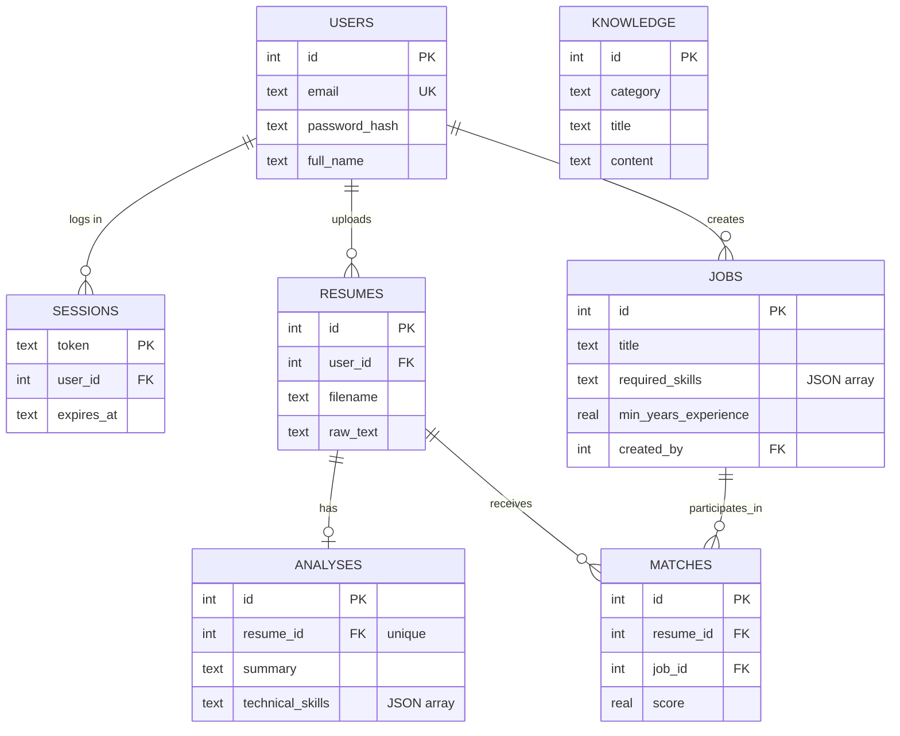

# AI Resume Analyzer

Web app that analyzes uploaded resumes with AI agents, matches them against jobs,
and answers career questions with RAG-grounded advice.

Built to the SRS: **Python + FastAPI**, **SQLite**, **HTML/CSS/vanilla JavaScript**
(no frontend frameworks).

## Features (SRS mapping)

| SRS | Feature |
|-----|---------|
| FR-1 | Register / Login / Logout (session cookie, PBKDF2-hashed passwords) |
| FR-2 | Resume upload (PDF or DOCX, ≤ 5 MB) with text extraction |
| FR-3 | Resume analysis: skills, education, experience, summary, strengths/weaknesses |
| FR-4 | Job recommendations: score /100, matched & missing skills, explanation |
| FR-5 | Resume improvement: missing skills, weaknesses, improvements, certifications, resources |
| FR-6 | Job management: create, edit, delete, view |
| FR-7 | Job search by keyword, location and skill |
| AI | Resume Analyzer Agent, Job Matching Agent, Career Advisor Agent (LangChain) |
| RAG | Advisor retrieves from the `knowledge` table before generating answers |

## Quick start

```powershell
# 1. install dependencies
python -m pip install -r requirements.txt
# 2. configure the LLM (OpenRouter free models or any OpenAI-compatible API)
Copy-Item .env.example .env   # then edit .env and paste your key
# 3. run (DB is created and seeded automatically on first run)
python -m uvicorn app.main:app --reload
# 4. open http://127.0.0.1:8000/
```

Demo login: **demo@example.com / demo12345** (8 jobs pre-seeded, owned by this user).

## Demo script (5 minutes)

1. Open `/register.html` → create an account (or log in with the demo user).
2. `/analyze.html` → drag in a PDF/DOCX resume → analysis, skill chips and score bars appear.
3. Review **Recommended jobs** — score, matched/missing skills, explanation.
4. Enter a target role under **Improve this resume** → missing skills, certifications, resources.
5. `/jobs.html` → search `"fastapi"`, add a job, edit it, delete it.
6. `/advisor.html` → ask `"What should I learn next for a backend job?"` → grounded answer.
7. Log out → any API call now returns 401.

## API documentation

Interactive docs: **http://127.0.0.1:8000/docs** (OpenAPI schema at `/openapi.json`).

All endpoints return JSON. Errors are `{"detail": "<message>"}`.
Auth endpoints are public; everything else requires the `sid` session cookie (401 otherwise).

| Method | Path | Body / params | Returns |
|--------|------|---------------|---------|
| POST | `/api/auth/register` | `{email, password, full_name?}` | 201 `{id, email, full_name}` + cookie |
| POST | `/api/auth/login` | `{email, password}` | `{id, email, full_name}` + cookie |
| POST | `/api/auth/logout` | — | `{ok}` |
| GET | `/api/auth/me` | — | `{id, email, full_name}` |
| POST | `/api/resumes` | multipart `file` | 201 `{resume_id, analysis}` |
| GET | `/api/resumes` | — | `[{id, filename, uploaded_at, summary, full_name}]` |
| GET | `/api/resumes/{id}` | — | `{id, filename, uploaded_at, analysis}` |
| GET | `/api/resumes/{id}/matches` | — | `[{job_id, title, company, location, score, matched_skills, missing_skills, explanation}]` |
| POST | `/api/resumes/{id}/improve` | `{target_role}` | `{missing_skills, weaknesses, improvements, certifications, learning_resources}` |
| GET | `/api/jobs` | `?q=&location=&skill=` | `[Job]` |
| POST | `/api/jobs` | `{title, company?, location?, description?, required_skills?, min_years_experience?}` | 201 `Job` |
| GET | `/api/jobs/{id}` | — | `Job` |
| PUT | `/api/jobs/{id}` | same as POST | `Job` (owner only, else 403) |
| DELETE | `/api/jobs/{id}` | — | `{ok}` (owner only, else 403) |
| POST | `/api/advisor/ask` | `{question, resume_id?, history?}` | `{answer}` |

Example:

```powershell
curl -c jar.txt -X POST http://127.0.0.1:8000/api/auth/login `
  -H "Content-Type: application/json" `
  -d "{\"email\":\"demo@example.com\",\"password\":\"demo12345\"}"
curl -b jar.txt "http://127.0.0.1:8000/api/jobs?skill=fastapi"
```

## ER diagram



## How the AI works

- **Resume Analyzer Agent** (`app/agents/resume_analyzer.py`) — one structured LLM call extracts the `ResumeAnalysis` schema from raw text.
- **Job Matching Agent** (`app/agents/job_matcher.py`) — deterministic score = 75% skill overlap + 25% experience fit; an LLM writes the explanation (falls back to a rule-based explanation if the LLM is down).
- **Career Advisor Agent** (`app/agents/career_advisor.py`) — LangChain agent with a `search_knowledge_base` tool; the system prompt forces retrieval before answering (RAG).
- **Knowledge base** (`knowledge` table, retrieved by `app/agents/knowledge.py`) — roadmaps, skill descriptions, certifications, learning resources, resume guidelines, job description samples; keyword-overlap retrieval.

LLM configuration lives in `.env`: `LLM_API_KEY`, `LLM_BASE_URL`, `LLM_MODEL`.
The model must support **tool/function calling** (needed for structured output).
If analysis returns 502, check the key/URL or switch `LLM_MODEL` to another tool-capable model.

## Project structure

```
app/
  main.py        FastAPI app, static serving, error handlers
  config.py      env settings
  db.py          SQLite connection, schema init, auto-seed
  schema.sql     DDL (7 tables)
  security.py    PBKDF2 hashing, session cookies
  routers/       auth.py, resumes.py, jobs.py, advisor.py
  services/      extraction.py (PDF/DOCX text)
  agents/        resume_analyzer, job_matcher, career_advisor, knowledge, llm
static/          HTML pages, css/, js/ (vanilla)
data/app.db      created + seeded on first run
```
