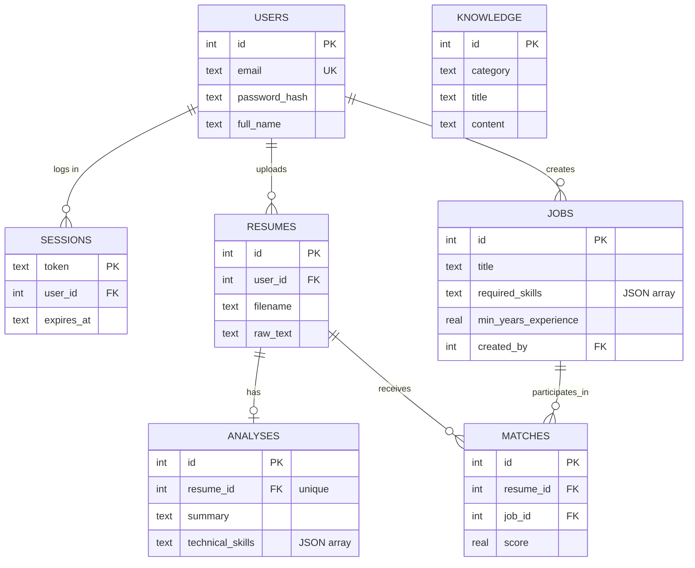

# AI Resume Analyzer Implementation Plan

> **For agentic workers:** REQUIRED SUB-SKILL: Use superpowers:subagent-driven-development (recommended) or superpowers:executing-plans to implement this plan task-by-task. Steps use checkbox (`- [x]`) syntax for tracking.

**Goal:** Complete the partially-built project into a full SRS-compliant web app: FastAPI + SQLite + vanilla JS frontend, 3 AI agents, RAG, auth, resume upload/analysis, job matching/CRUD/search, career advisor, docs and ER diagram.

**Architecture:** JSON REST API under `/api/*` on FastAPI with session-cookie auth and stdlib `sqlite3` (schema.sql + db.py, auto-seeded). Existing LangChain agents in `app/agents/` stay the AI core (llm.py becomes env-driven; knowledge.py becomes DB-backed RAG). Static multi-page vanilla-JS frontend served by FastAPI.

**Tech Stack:** Python 3.12, FastAPI, uvicorn, sqlite3, pypdf, python-docx, langchain 1.x + langchain-openai (OpenRouter/OpenAI-compatible), vanilla HTML/CSS/JS.

**Spec:** `docs/superpowers/specs/2026-09-29-ai-resume-analyzer-design.md` — executors read the spec and this plan together.

## Global Constraints

- SRS §2 tech lock: backend = Python + FastAPI only; database = SQLite only; frontend = HTML + CSS + vanilla JavaScript only. No React/Angular/Vue/Jinja2.
- Auth = server-side sessions: cookie `sid`, httpOnly, SameSite=Lax, 7-day TTL; passwords = PBKDF2-HMAC-SHA256, per-user salt, 200,000 iterations.
- Seeded demo user: `demo@example.com` / `demo12345`; all seeded jobs have `created_by` = demo user id.
- Uploads: only `.pdf`/`.docx`, ≤ 5,242,880 bytes (`MAX_UPLOAD_BYTES`), extractable text ≥ 50 chars.
- LLM via `.env` only: `LLM_API_KEY`, `LLM_BASE_URL` (default `https://openrouter.ai/api/v1`), `LLM_MODEL`. Never hardcode keys.
- All `/api/*` routes require a valid session (401) except `POST /api/auth/register` and `POST /api/auth/login`.
- LLM/provider failures → HTTP 502 with `{"detail": "<friendly message>"}`; never leak stack traces; log server-side.
- Verification = the manual commands in each task (user explicitly declined an automated test suite). No `pytest`.
- No git commits (workspace is not a git repo; user has not requested version control).
- Working directory for every command: `D:\work\ITI AI\Project Resume Analyzer`.

## HTTP Verification Pattern (used by Tasks 4, 8–10, 15–16)

PowerShell + `curl.exe` (NOT the `curl` alias). JSON bodies go in files to dodge PS 5.1 quoting:

```powershell
# start server (once per session, if not running)
if (-not (Get-NetTCPConnection -LocalPort 8000 -State Listen -ErrorAction SilentlyContinue)) {
  Start-Process -FilePath python -ArgumentList "-m","uvicorn","app.main:app","--port","8000" `
    -WorkingDirectory "D:\work\ITI AI\Project Resume Analyzer" -WindowStyle Hidden
  Start-Sleep 4
}
# JSON POST example (body written to a temp file first)
Set-Content -Path $env:TEMP\b.json -Value '{"email":"demo@example.com","password":"demo12345"}'
curl.exe -s -w "`nHTTP %{http_code}" -c "$env:TEMP\jar.txt" -X POST http://127.0.0.1:8000/api/auth/login `
  -H "Content-Type: application/json" -d "@$env:TEMP\b.json"
# -c saves cookies, -b replays them on later calls
# stop server when done:
Get-NetTCPConnection -LocalPort 8000 -State Listen -ErrorAction SilentlyContinue |
  ForEach-Object { Stop-Process -Id $_.OwningProcess }
```

## Review Focus

1. **Bad uploads (oversized, wrong extension, empty/scanned file)** → must return 400 with a human-readable message, never 500/traceback. Pinned in Task 9 (bad-upload curls).
2. **Another user's resource (resume/job) referenced by id** → must return 404 (resume) / 403 (job edit), leaking nothing. Pinned in Task 8 (second-user PUT → 403), Task 9 (second-user GET → 404), Task 10 (foreign resume_id → 404).
3. **LLM key missing or provider down** → 502 `{"detail": ...}` with a config hint; scoring paths degrade gracefully with a fallback explanation instead of crashing. Pinned in Task 7 (offline `match_jobs`), Task 9 (502-on-no-key branch), Task 10 (502 branch).
4. **Invalid/expired/absent session cookie** → 401 JSON on API calls; browser pages redirect to `/login.html`. Pinned in Task 4 (me without cookie → 401, after logout → 401) and Task 16 E2E.
5. **Empty result sets (search with no hits, no jobs, no KB retrieval)** → empty-state message in UI, `[]` from API. Pinned in Task 8 (`?q=zzzz` → `[]`), Task 13 (empty-state render).

---

### Task 1: Project foundation — package fixes, config, dependencies, env files

**Files:**
- Create: `app/__init__.py`, `app/config.py`, `requirements.txt`, `.env.example`, `.gitignore`
- Rename: `app/agents/init.py` → `app/agents/__init__.py`

**Interfaces:**
- Consumes: nothing
- Produces: `app.config` module constants `DB_PATH (Path)`, `LLM_API_KEY (str)`, `LLM_BASE_URL (str)`, `LLM_MODEL (str)`, `SESSION_TTL_DAYS (int)`, `MAX_UPLOAD_BYTES (int)`, `ALLOWED_EXTENSIONS (set[str])`, `BASE_DIR (Path)` — used by every later task.

- [x] **Step 1: Rename the package init and add empty `app/__init__.py`**

```powershell
Move-Item -LiteralPath "app\agents\init.py" -Destination "app\agents\__init__.py" -Force
Set-Content -Path "app\__init__.py" -Value ""
```

- [x] **Step 2: Write `app/config.py`**

```python
import os
from pathlib import Path

from dotenv import load_dotenv

load_dotenv()

BASE_DIR = Path(__file__).resolve().parent.parent
DB_PATH = Path(os.getenv("DB_PATH", str(BASE_DIR / "data" / "app.db")))

LLM_API_KEY = os.getenv("LLM_API_KEY", "")
LLM_BASE_URL = os.getenv("LLM_BASE_URL", "https://openrouter.ai/api/v1")
LLM_MODEL = os.getenv("LLM_MODEL", "meta-llama/llama-3.3-70b-instruct:free")

SESSION_TTL_DAYS = int(os.getenv("SESSION_TTL_DAYS", "7"))
MAX_UPLOAD_BYTES = int(os.getenv("MAX_UPLOAD_BYTES", str(5 * 1024 * 1024)))
ALLOWED_EXTENSIONS = {".pdf", ".docx"}
```

- [x] **Step 3: Write `requirements.txt`**

```text
fastapi>=0.115
uvicorn>=0.30
python-multipart>=0.0.9
pypdf>=4.0
python-docx>=1.1
python-dotenv>=1.0
pydantic>=2.7
langchain>=1.0
langchain-openai>=1.0
```

- [x] **Step 4: Write `.env.example` and `.gitignore`**

```text
# .env.example — copy to .env and fill in.
# Get a free key at https://openrouter.ai/keys (or use any OpenAI-compatible provider)
LLM_API_KEY=sk-or-put-your-key-here
LLM_BASE_URL=https://openrouter.ai/api/v1
# Must be a model that supports tool/function calling.
# Free options: meta-llama/llama-3.3-70b-instruct:free, deepseek/deepseek-chat-v3-0324:free
# Check https://openrouter.ai/models?modality=tools for current tool-capable free models.
LLM_MODEL=meta-llama/llama-3.3-70b-instruct:free
SESSION_TTL_DAYS=7
MAX_UPLOAD_BYTES=5242880
```

```text
# .gitignore
.env
data/
__pycache__/
*.pyc
```

- [x] **Step 5: Install dependencies and verify imports**

```powershell
python -m pip install -r requirements.txt --disable-pip-version-check
python -c "from app.agents import analyze_resume, match_jobs, ask_advisor, improve_resume; from app import config; print('imports OK', config.LLM_MODEL)"
```

Expected: `imports OK meta-llama/llama-3.3-70b-instruct:free` and no ImportError (this is the `init.py` → `__init__.py` fix proving out).

---

### Task 2: SQLite schema, DB layer, auto-seed

**Files:**
- Create: `app/schema.sql`, `app/db.py`

**Interfaces:**
- Consumes: `app.config.DB_PATH`; `app.security.hash_password` (written in Task 3 — imported lazily inside `init_db()`, so Task 3 must land before the first `init_db()` run; defer Step 3 until then)
- Produces:
  - `db.connect() -> sqlite3.Connection` (Row factory, FK on)
  - `db.get_db()` context manager (yield conn, commit, close)
  - `db.init_db()` — creates tables, seeds demo user + 8 jobs + 16 knowledge rows (idempotent)
  - `db.row_to_job(row) -> dict` with parsed `required_skills`
  - `db.SEED_JOBS`, `db.SEED_KNOWLEDGE`
  - Tables per spec §4: `users, sessions, jobs, resumes, analyses, matches, knowledge`

- [x] **Step 1: Write `app/schema.sql`**

```sql
CREATE TABLE IF NOT EXISTS users (
  id INTEGER PRIMARY KEY AUTOINCREMENT,
  email TEXT NOT NULL UNIQUE COLLATE NOCASE,
  password_hash TEXT NOT NULL,
  full_name TEXT NOT NULL DEFAULT '',
  created_at TEXT NOT NULL DEFAULT (datetime('now'))
);

CREATE TABLE IF NOT EXISTS sessions (
  token TEXT PRIMARY KEY,
  user_id INTEGER NOT NULL REFERENCES users(id) ON DELETE CASCADE,
  created_at TEXT NOT NULL DEFAULT (datetime('now')),
  expires_at TEXT NOT NULL
);

CREATE TABLE IF NOT EXISTS jobs (
  id INTEGER PRIMARY KEY AUTOINCREMENT,
  title TEXT NOT NULL,
  company TEXT NOT NULL DEFAULT '',
  location TEXT NOT NULL DEFAULT '',
  description TEXT NOT NULL DEFAULT '',
  required_skills TEXT NOT NULL DEFAULT '[]',
  min_years_experience REAL NOT NULL DEFAULT 0,
  created_by INTEGER REFERENCES users(id) ON DELETE SET NULL,
  created_at TEXT NOT NULL DEFAULT (datetime('now')),
  updated_at TEXT NOT NULL DEFAULT (datetime('now'))
);

CREATE TABLE IF NOT EXISTS resumes (
  id INTEGER PRIMARY KEY AUTOINCREMENT,
  user_id INTEGER NOT NULL REFERENCES users(id) ON DELETE CASCADE,
  filename TEXT NOT NULL,
  raw_text TEXT NOT NULL,
  uploaded_at TEXT NOT NULL DEFAULT (datetime('now'))
);

CREATE TABLE IF NOT EXISTS analyses (
  id INTEGER PRIMARY KEY AUTOINCREMENT,
  resume_id INTEGER NOT NULL UNIQUE REFERENCES resumes(id) ON DELETE CASCADE,
  full_name TEXT NOT NULL DEFAULT '',
  email TEXT NOT NULL DEFAULT '',
  years_experience REAL NOT NULL DEFAULT 0,
  summary TEXT NOT NULL DEFAULT '',
  technical_skills TEXT NOT NULL DEFAULT '[]',
  soft_skills TEXT NOT NULL DEFAULT '[]',
  education TEXT NOT NULL DEFAULT '[]',
  experience TEXT NOT NULL DEFAULT '[]',
  strengths TEXT NOT NULL DEFAULT '[]',
  weaknesses TEXT NOT NULL DEFAULT '[]',
  created_at TEXT NOT NULL DEFAULT (datetime('now'))
);

CREATE TABLE IF NOT EXISTS matches (
  id INTEGER PRIMARY KEY AUTOINCREMENT,
  resume_id INTEGER NOT NULL REFERENCES resumes(id) ON DELETE CASCADE,
  job_id INTEGER NOT NULL REFERENCES jobs(id) ON DELETE CASCADE,
  score REAL NOT NULL,
  matched_skills TEXT NOT NULL DEFAULT '[]',
  missing_skills TEXT NOT NULL DEFAULT '[]',
  explanation TEXT NOT NULL DEFAULT '',
  created_at TEXT NOT NULL DEFAULT (datetime('now'))
);

CREATE TABLE IF NOT EXISTS knowledge (
  id INTEGER PRIMARY KEY AUTOINCREMENT,
  category TEXT NOT NULL,
  title TEXT NOT NULL,
  content TEXT NOT NULL
);
```

- [x] **Step 2: Write `app/db.py`**

```python
import json
import sqlite3
from contextlib import contextmanager
from pathlib import Path

from .config import DB_PATH

SEED_JOBS = [
    {"title": "Junior Backend Developer", "company": "Tech Solutions", "location": "Cairo, Egypt",
     "description": "Build and maintain REST APIs with Python and FastAPI. Work with SQL databases, write tests, and containerize services with Docker.",
     "required_skills": ["Python", "FastAPI", "SQL", "Docker"], "min_years_experience": 1},
    {"title": "Mid Backend Engineer", "company": "Nile Software House", "location": "Remote",
     "description": "Design scalable backend services, own database schemas, and improve API performance for a SaaS product.",
     "required_skills": ["Python", "Django", "PostgreSQL", "Kubernetes"], "min_years_experience": 3},
    {"title": "Frontend Developer", "company": "Pixel Agency", "location": "Giza, Egypt",
     "description": "Implement responsive, accessible interfaces from designs. Collaborate with designers and backend engineers on a component library.",
     "required_skills": ["JavaScript", "HTML", "CSS", "React"], "min_years_experience": 2},
    {"title": "Machine Learning Engineer", "company": "DataWorks", "location": "Remote",
     "description": "Train and evaluate models, build data pipelines, and deploy predictions to production endpoints.",
     "required_skills": ["Python", "scikit-learn", "Pandas", "Docker", "SQL"], "min_years_experience": 2},
    {"title": "Data Analyst", "company": "Retail Group", "location": "Cairo, Egypt",
     "description": "Turn sales data into dashboards and reports, clean datasets, and support stakeholders with ad-hoc analysis.",
     "required_skills": ["SQL", "Pandas", "Excel", "Tableau"], "min_years_experience": 1},
    {"title": "AI Engineer", "company": "Startup Lab", "location": "Remote",
     "description": "Integrate LLM APIs into product features, build RAG pipelines, and evaluate prompt and retrieval quality.",
     "required_skills": ["Python", "LLM APIs", "RAG", "LangChain", "Vector databases"], "min_years_experience": 2},
    {"title": "Junior DevOps Engineer", "company": "CloudNine", "location": "Alexandria, Egypt (Hybrid)",
     "description": "Maintain CI/CD pipelines, containerize applications, and monitor cloud infrastructure.",
     "required_skills": ["Docker", "Linux", "Bash", "CI/CD", "AWS"], "min_years_experience": 1},
    {"title": "QA Automation Engineer", "company": "Quality First", "location": "Cairo, Egypt",
     "description": "Write automated tests for web and API features, maintain test suites, and report bugs clearly.",
     "required_skills": ["Python", "Pytest", "Selenium", "API testing"], "min_years_experience": 1},
]

SEED_KNOWLEDGE = [
    ("roadmap", "Backend Developer roadmap",
     "learn Python, FastAPI, SQL, REST design, authentication with JWT, Docker, testing with pytest, then CI/CD and cloud basics."),
    ("roadmap", "Data Scientist roadmap",
     "Python, pandas, NumPy, statistics, scikit-learn, feature engineering, model evaluation, then deep learning and MLOps."),
    ("roadmap", "AI Engineer roadmap",
     "Python, LLM APIs, prompt engineering, LangChain, vector databases, RAG, evaluation, and deployment of AI services."),
    ("roadmap", "Frontend Developer roadmap",
     "HTML, CSS, JavaScript, DOM, fetch API, accessibility, responsive design, then a framework and build tools."),
    ("certification", "Certifications",
     "AWS Certified Cloud Practitioner for cloud basics; Google Data Analytics Certificate for analytics; TensorFlow Developer Certificate for deep learning; Microsoft Azure AI Fundamentals AI-900 for applied AI."),
    ("resource", "Learning resources",
     "freeCodeCamp for web development, Coursera Machine Learning Specialization for ML, DeepLearning.AI short courses for LLMs, official FastAPI documentation for backend APIs, LangChain documentation for agents."),
    ("guideline", "Resume writing guidelines",
     "keep it to one page for under ten years of experience, lead bullets with action verbs, quantify results, list skills grouped by category, tailor keywords to the job description, avoid photos and dense paragraphs."),
    ("skill", "Skill description SQL",
     "querying relational databases, joins, aggregation, indexing and schema design. Required for most backend and data roles."),
    ("skill", "Skill description Docker",
     "packaging applications into containers for reproducible deployment. Expected for backend, DevOps and MLOps roles."),
    ("skill", "Skill description REST APIs",
     "designing stateless HTTP endpoints with correct status codes, validation, pagination and versioning. Core requirement for backend roles."),
    ("skill", "Skill description Git",
     "branching, pull requests, meaningful commits and conflict resolution. Expected in every software team."),
    ("skill", "Soft skills employers value",
     "communication, teamwork, problem solving, time management, adaptability and ownership of tasks."),
    ("job_description", "Backend developer job description sample",
     "responsible for designing and implementing server-side logic, managing databases, integrating third-party services, and ensuring API reliability, security and performance."),
    ("job_description", "Machine learning engineer job description sample",
     "responsible for data preparation, model training and evaluation, experiment tracking, and deploying models behind APIs with monitoring."),
    ("job_description", "Frontend developer job description sample",
     "responsible for building responsive user interfaces, implementing designs faithfully, optimizing page performance, and ensuring accessibility."),
    ("guideline", "How to tailor a resume to a job description",
     "mirror the exact skill names used in the posting, put the most relevant projects first, and move matching keywords into a visible skills section."),
]


def connect() -> sqlite3.Connection:
    DB_PATH.parent.mkdir(parents=True, exist_ok=True)
    conn = sqlite3.connect(DB_PATH)
    conn.row_factory = sqlite3.Row
    conn.execute("PRAGMA foreign_keys = ON")
    return conn


@contextmanager
def get_db():
    conn = connect()
    try:
        yield conn
        conn.commit()
    finally:
        conn.close()


def init_db() -> None:
    from .security import hash_password

    schema = (Path(__file__).parent / "schema.sql").read_text(encoding="utf-8")
    with get_db() as conn:
        conn.executescript(schema)
        if conn.execute("SELECT COUNT(*) AS c FROM users").fetchone()["c"] == 0:
            conn.execute(
                "INSERT INTO users (email, password_hash, full_name) VALUES (?, ?, ?)",
                ("demo@example.com", hash_password("demo12345"), "Demo User"),
            )
        if conn.execute("SELECT COUNT(*) AS c FROM jobs").fetchone()["c"] == 0:
            demo_id = conn.execute(
                "SELECT id FROM users WHERE email = ?", ("demo@example.com",)
            ).fetchone()["id"]
            for job in SEED_JOBS:
                conn.execute(
                    "INSERT INTO jobs (title, company, location, description, required_skills,"
                    " min_years_experience, created_by) VALUES (?, ?, ?, ?, ?, ?, ?)",
                    (
                        job["title"], job["company"], job["location"], job["description"],
                        json.dumps(job["required_skills"]), job["min_years_experience"], demo_id,
                    ),
                )
        if conn.execute("SELECT COUNT(*) AS c FROM knowledge").fetchone()["c"] == 0:
            for category, title, content in SEED_KNOWLEDGE:
                conn.execute(
                    "INSERT INTO knowledge (category, title, content) VALUES (?, ?, ?)",
                    (category, title, content),
                )


def row_to_job(row: sqlite3.Row) -> dict:
    return {
        "id": row["id"],
        "title": row["title"],
        "company": row["company"],
        "location": row["location"],
        "description": row["description"],
        "required_skills": json.loads(row["required_skills"]),
        "min_years_experience": row["min_years_experience"],
        "created_by": row["created_by"],
        "created_at": row["created_at"],
        "updated_at": row["updated_at"],
    }
```

- [x] **Step 3: Verify DB init + seed (requires `app/security.py` from Task 3 — defer until Task 3 is done)**

```powershell
Remove-Item -Recurse -Force data -ErrorAction SilentlyContinue
python -c "from app.db import init_db, get_db; init_db(); conn=get_db().__enter__(); print('users', conn.execute('select count(*) c from users').fetchone()['c']); print('jobs', conn.execute('select count(*) c from jobs').fetchone()['c']); print('knowledge', conn.execute('select count(*) c from knowledge').fetchone()['c'])"
```

Expected: `users 1`, `jobs 8`, `knowledge 16`. Re-running init_db must not duplicate rows (counts stay the same).

### Task 3: Password hashing and session helpers

**Files:**
- Create: `app/security.py`

**Interfaces:**
- Consumes: `app.config.SESSION_TTL_DAYS`; DB tables `users`, `sessions` (Task 2)
- Produces (used by Tasks 2, 4, 8–10):
  - `hash_password(password: str) -> str`
  - `verify_password(password: str, stored: str) -> bool`
  - `create_session(conn, user_id: int) -> str` (returns token; caller's `get_db()` commits)
  - `delete_session(conn, token: str) -> None`
  - `get_current_user(sid: str | None = Cookie(alias="sid")) -> dict` → `{"id", "email", "full_name"}`, raises `HTTPException(401)` when absent/invalid

- [x] **Step 1: Write `app/security.py`**

```python
import hashlib
import secrets
from datetime import datetime, timedelta, timezone

from fastapi import Cookie, HTTPException

from .config import SESSION_TTL_DAYS


def hash_password(password: str) -> str:
    salt = secrets.token_hex(16)
    dk = hashlib.pbkdf2_hmac("sha256", password.encode("utf-8"), bytes.fromhex(salt), 200_000)
    return f"pbkdf2_sha256${salt}${dk.hex()}"


def verify_password(password: str, stored: str) -> bool:
    try:
        _, salt, expected = stored.split("$")
    except (ValueError, AttributeError):
        return False
    dk = hashlib.pbkdf2_hmac("sha256", password.encode("utf-8"), bytes.fromhex(salt), 200_000)
    return secrets.compare_digest(dk.hex(), expected)


def create_session(conn, user_id: int) -> str:
    token = secrets.token_hex(32)
    expires = datetime.now(timezone.utc) + timedelta(days=SESSION_TTL_DAYS)
    conn.execute(
        "INSERT INTO sessions (token, user_id, expires_at) VALUES (?, ?, ?)",
        (token, user_id, expires.strftime("%Y-%m-%d %H:%M:%S")),
    )
    return token


def delete_session(conn, token: str) -> None:
    conn.execute("DELETE FROM sessions WHERE token = ?", (token,))


def get_current_user(sid: str | None = Cookie(default=None, alias="sid")) -> dict:
    if not sid:
        raise HTTPException(status_code=401, detail="Not logged in")
    from .db import get_db

    with get_db() as conn:
        row = conn.execute(
            "SELECT u.id, u.email, u.full_name FROM sessions s"
            " JOIN users u ON u.id = s.user_id"
            " WHERE s.token = ? AND s.expires_at > datetime('now')",
            (sid,),
        ).fetchone()
    if row is None:
        raise HTTPException(status_code=401, detail="Session expired or invalid")
    return {"id": row["id"], "email": row["email"], "full_name": row["full_name"]}
```

- [x] **Step 2: Verify hashing round-trip**

```powershell
python -c "from app.security import hash_password, verify_password; h = hash_password('demo12345'); print('hash-ok', verify_password('demo12345', h)); print('wrong-rejected', verify_password('nope', h)); print('unique-salts', hash_password('demo12345') != h)"
```

Expected: `hash-ok True`, `wrong-rejected False`, `unique-salts True`.

- [x] **Step 3: Verify `init_db()` seeds the demo user (also completes Task 2 Step 3)**

```powershell
Remove-Item -Recurse -Force data -ErrorAction SilentlyContinue
python -c "from app.db import init_db; init_db(); from app.security import verify_password; from app.db import get_db; conn=get_db().__enter__(); row=conn.execute('select password_hash from users where email=?',('demo@example.com',)).fetchone(); print('demo-login-ok', verify_password('demo12345', row['password_hash']))"
```

Expected: `demo-login-ok True`, `data\app.db` exists. Then run Task 2 Step 3's count check (`users 1 / jobs 8 / knowledge 16`).

---

### Task 4: FastAPI app + auth endpoints (FR-1)

**Files:**
- Create: `app/main.py`, `app/routers/__init__.py`, `app/routers/auth.py`

**Interfaces:**
- Consumes: Task 2 `db.get_db/init_db`, Task 3 `hash_password/verify_password/create_session/delete_session`
- Produces:
  - `app.main:app` (uvicorn target) with lifespan running `init_db()`, global exception handlers, static mount
  - `app.routers.auth.router` (`prefix=/api/auth`): `POST /register` (201), `POST /login`, `POST /logout`, `GET /me`

- [x] **Step 1: Write `app/routers/__init__.py` (empty) and `app/routers/auth.py`**

```python
# app/routers/__init__.py — empty file
```

```python
import re

from fastapi import APIRouter, Cookie, Depends, HTTPException, Response
from pydantic import BaseModel, Field

from .. import config, db as dbm
from ..security import (
    create_session,
    delete_session,
    get_current_user,
    hash_password,
    verify_password,
)

router = APIRouter(prefix="/api/auth", tags=["auth"])
EMAIL_RE = re.compile(r"^[^@\s]+@[^@\s]+\.[^@\s]+$")


class RegisterIn(BaseModel):
    email: str = Field(min_length=5, max_length=254)
    password: str = Field(min_length=6, max_length=128)
    full_name: str = Field(default="", max_length=120)


class LoginIn(BaseModel):
    email: str = Field(min_length=3, max_length=254)
    password: str = Field(min_length=1, max_length=128)


def _set_cookie(response: Response, token: str) -> None:
    response.set_cookie(
        key="sid", value=token, httponly=True, samesite="lax",
        max_age=config.SESSION_TTL_DAYS * 86400, path="/",
    )


@router.post("/register", status_code=201)
def register(payload: RegisterIn, response: Response) -> dict:
    email = payload.email.strip().lower()
    if not EMAIL_RE.match(email):
        raise HTTPException(status_code=400, detail="Enter a valid email address.")
    with dbm.get_db() as conn:
        if conn.execute("SELECT 1 FROM users WHERE email = ?", (email,)).fetchone():
            raise HTTPException(status_code=409, detail="An account with this email already exists.")
        cursor = conn.execute(
            "INSERT INTO users (email, password_hash, full_name) VALUES (?, ?, ?)",
            (email, hash_password(payload.password), payload.full_name.strip()),
        )
        user_id = cursor.lastrowid
        token = create_session(conn, user_id)
    _set_cookie(response, token)
    return {"id": user_id, "email": email, "full_name": payload.full_name.strip()}


@router.post("/login")
def login(payload: LoginIn, response: Response) -> dict:
    with dbm.get_db() as conn:
        row = conn.execute(
            "SELECT id, email, password_hash, full_name FROM users WHERE email = ?",
            (payload.email.strip().lower(),),
        ).fetchone()
        if row is None or not verify_password(payload.password, row["password_hash"]):
            raise HTTPException(status_code=401, detail="Invalid email or password.")
        token = create_session(conn, row["id"])
    _set_cookie(response, token)
    return {"id": row["id"], "email": row["email"], "full_name": row["full_name"]}


@router.post("/logout")
def logout(response: Response, sid: str | None = Cookie(default=None, alias="sid")) -> dict:
    if sid:
        with dbm.get_db() as conn:
            delete_session(conn, sid)
    response.delete_cookie("sid", path="/")
    return {"ok": True}


@router.get("/me")
def me(user: dict = Depends(get_current_user)) -> dict:
    return user
```

- [x] **Step 2: Write `app/main.py`**

```python
import logging
from contextlib import asynccontextmanager

from fastapi import FastAPI, Request
from fastapi.exceptions import RequestValidationError
from fastapi.responses import JSONResponse
from fastapi.staticfiles import StaticFiles

from . import config
from .db import init_db
from .routers import auth

logger = logging.getLogger("uvicorn.error")


@asynccontextmanager
async def lifespan(app: FastAPI):
    init_db()
    yield


app = FastAPI(
    title="AI Resume Analyzer",
    version="1.0.0",
    description="Analyze resumes with AI agents, match jobs, and get RAG-grounded career advice.",
    lifespan=lifespan,
)

app.include_router(auth.router)


@app.exception_handler(RequestValidationError)
async def validation_handler(request: Request, exc: RequestValidationError) -> JSONResponse:
    parts = []
    for err in exc.errors():
        loc = ".".join(str(x) for x in err["loc"] if x != "body") or "body"
        parts.append(f"{loc}: {err['msg']}")
    return JSONResponse(status_code=422, content={"detail": "; ".join(parts)})


@app.exception_handler(Exception)
async def generic_handler(request: Request, exc: Exception) -> JSONResponse:
    logger.exception("Unhandled error on %s %s", request.method, request.url.path)
    return JSONResponse(status_code=500, content={"detail": "Internal server error"})


app.mount("/", StaticFiles(directory=config.BASE_DIR / "static", html=True), name="static")
```

Note: `static/` does not exist yet — create it now so the server boots:

```powershell
New-Item -ItemType Directory -Force -Path static, static\css, static\js | Out-Null
```

- [x] **Step 3: Start the server (use the HTTP Verification Pattern from the top of this plan)**

```powershell
if (-not (Get-NetTCPConnection -LocalPort 8000 -State Listen -ErrorAction SilentlyContinue)) {
  Start-Process -FilePath python -ArgumentList "-m","uvicorn","app.main:app","--port","8000" `
    -WorkingDirectory "D:\work\ITI AI\Project Resume Analyzer" -WindowStyle Hidden
  Start-Sleep 4
}
curl.exe -s -o $null -w "docs: %{http_code}" http://127.0.0.1:8000/docs
```

Expected: `docs: 200` (the auto API documentation — a required deliverable).

- [x] **Step 4: Verify register → me → logout flow**

```powershell
Set-Content -Path $env:TEMP\reg.json -Value '{"email":"newbie@example.com","password":"secret123","full_name":"New User"}'
curl.exe -s -w "`nHTTP %{http_code}" -c "$env:TEMP\jar2.txt" -X POST http://127.0.0.1:8000/api/auth/register -H "Content-Type: application/json" -d "@$env:TEMP\reg.json"
curl.exe -s -w "`nHTTP %{http_code}" -b "$env:TEMP\jar2.txt" http://127.0.0.1:8000/api/auth/me
```

Expected: `HTTP 201` with `{"id":..,"email":"newbie@example.com","full_name":"New User"}`; then `HTTP 200` with the same user.

- [x] **Step 5: Verify failure paths (Review Focus #4)**

```powershell
# wrong password -> 401
Set-Content -Path $env:TEMP\bad.json -Value '{"email":"newbie@example.com","password":"wrongpass"}'
curl.exe -s -w "`nHTTP %{http_code}" -X POST http://127.0.0.1:8000/api/auth/login -H "Content-Type: application/json" -d "@$env:TEMP\bad.json"
# no cookie -> 401
curl.exe -s -w "`nHTTP %{http_code}" http://127.0.0.1:8000/api/auth/me
# duplicate email -> 409
curl.exe -s -w "`nHTTP %{http_code}" -X POST http://127.0.0.1:8000/api/auth/register -H "Content-Type: application/json" -d "@$env:TEMP\reg.json"
# short password -> 422 with readable string detail
Set-Content -Path $env:TEMP\weak.json -Value '{"email":"weak@example.com","password":"123"}'
curl.exe -s -w "`nHTTP %{http_code}" -X POST http://127.0.0.1:8000/api/auth/register -H "Content-Type: application/json" -d "@$env:TEMP\weak.json"
# logout then me -> 401
curl.exe -s -o $null -X POST -b "$env:TEMP\jar2.txt" -c "$env:TEMP\jar2.txt" http://127.0.0.1:8000/api/auth/logout
curl.exe -s -w "`nHTTP %{http_code}" -b "$env:TEMP\jar2.txt" http://127.0.0.1:8000/api/auth/me
```

Expected respectively: `401 Invalid email or password.`; `401 Not logged in`; `409 ...already exists`; `422 password: String should have at least 6 characters`; `401 Session expired or invalid`.

---

### Task 5: PDF/DOCX text extraction service (FR-2 support)

**Files:**
- Create: `app/services/__init__.py`, `app/services/extraction.py`

**Interfaces:**
- Consumes: `app.config.ALLOWED_EXTENSIONS`, pypdf, python-docx
- Produces: `services.extraction.extract_text(filename: str, data: bytes) -> str`; raises `ExtractionError` (subclass of `ValueError`) with a user-readable message for wrong type / unreadable / no text. Consumed by Task 9.

- [x] **Step 1: Write `app/services/__init__.py` (empty) and `app/services/extraction.py`**

```python
# app/services/__init__.py — empty file
```

```python
from io import BytesIO
from pathlib import Path

from docx import Document
from pypdf import PdfReader

from ..config import ALLOWED_EXTENSIONS


class ExtractionError(ValueError):
    """Raised when an uploaded file cannot be turned into usable text."""


def extract_text(filename: str, data: bytes) -> str:
    ext = Path(filename or "").suffix.lower()
    if ext not in ALLOWED_EXTENSIONS:
        raise ExtractionError("Unsupported file type. Please upload a PDF or DOCX file.")

    if ext == ".pdf":
        try:
            reader = PdfReader(BytesIO(data))
            text = "\n".join(page.extract_text() or "" for page in reader.pages)
        except Exception as exc:
            raise ExtractionError(
                "Could not read this PDF. It may be corrupted or password protected."
            ) from exc
    else:
        try:
            doc = Document(BytesIO(data))
            parts = [p.text for p in doc.paragraphs]
            for table in doc.tables:
                for row in table.rows:
                    parts.append(" | ".join(cell.text for cell in row.cells))
            text = "\n".join(parts)
        except Exception as exc:
            raise ExtractionError("Could not read this DOCX file.") from exc

    text = text.strip()
    if len(text) < 50:
        raise ExtractionError(
            "No readable text found in this file. Scanned/image-only files are not supported."
        )
    return text
```

- [x] **Step 2: Verify against a real PDF, a generated DOCX, and bad inputs**

```powershell
python -c @'
from app.services.extraction import extract_text, ExtractionError
pdf = open(r"D:\ITI\AI Agents\AI_Resume_Analyzer.pdf", "rb").read()
print("pdf-chars", len(extract_text("spec.pdf", pdf)))
from docx import Document
from io import BytesIO
buf = BytesIO(); d = Document()
d.add_paragraph("Sara Ahmed | sara@example.com. Computer Science graduate. Skills: Python, FastAPI, SQL, Git. Built REST APIs and trained classifiers.")
d.save(buf)
print("docx-chars", len(extract_text("r.docx", buf.getvalue())))
for name, data in [("x.txt", b"hello"), ("x.pdf", b"not a real pdf"), ("x.docx", b"zz")]:
    try:
        extract_text(name, data); print("FAIL no error", name)
    except ExtractionError as e:
        print("ok-rejected", name, "->", str(e)[:45])
'@
```

Expected: `pdf-chars` > 500, `docx-chars` > 80, then three `ok-rejected` lines (unsupported type / could not read PDF / could not read DOCX) — all as `ExtractionError`, never an unhandled traceback.

### Task 6: DB-backed RAG knowledge retrieval (RAG §5)

**Files:**
- Modify: `app/agents/knowledge.py` (replace whole file; keep `retrieve(query, k=4) -> list[str]` signature)

**Interfaces:**
- Consumes: `app.db.SEED_KNOWLEDGE` (fallback source), `knowledge` table from Task 2 seed
- Produces: `knowledge.retrieve(query: str, k: int = 4) -> list[str]` — used by `career_advisor.search_knowledge_base` tool and `improve_resume`; must work even when the DB has no tables yet (falls back to embedded seed text).

- [x] **Step 1: Rewrite `app/agents/knowledge.py`**

```python
import re

from .. import db as dbm

SEED_DOCS = [f"{title}: {content}" for _, title, content in dbm.SEED_KNOWLEDGE]


def _tokens(text: str) -> set[str]:
    return set(re.findall(r"[a-z0-9\+#\.]+", text.lower()))


def _all_docs() -> list[str]:
    try:
        with dbm.get_db() as conn:
            rows = conn.execute("SELECT title, content FROM knowledge").fetchall()
        if rows:
            return [f"{row['title']}: {row['content']}" for row in rows]
    except Exception:
        pass
    return list(SEED_DOCS)


def retrieve(query: str, k: int = 4) -> list[str]:
    docs = _all_docs()
    q = _tokens(query)
    scored = [(len(q & _tokens(doc)), doc) for doc in docs]
    scored = [item for item in scored if item[0] > 0]
    scored.sort(key=lambda item: item[0], reverse=True)
    return [doc for _, doc in scored[:k]]
```

- [x] **Step 2: Verify retrieval uses DB rows, and falls back cleanly**

```powershell
python -c "from app.db import init_db; init_db(); from app.agents.knowledge import retrieve; hits = retrieve('backend developer roadmap', 3); print('db-hits', len(hits)); print(hits[0][:60])"
```

Expected: `db-hits` ≥ 1 and the first hit starts with `Backend Developer roadmap`.

```powershell
$env:DB_PATH = "D:\no_such_dir_12345\missing.db"
python -c "from app.agents.knowledge import _all_docs, retrieve; print('fallback-docs', len(_all_docs())); print(retrieve('docker', 1))"
Remove-Item Env:\DB_PATH
```

Expected: `fallback-docs 16` and a docker-related doc — retrieval still answers from the embedded seed when DB content is unavailable.

---

### Task 7: Env-driven LLM + resilient match explanations

**Files:**
- Modify: `app/agents/llm.py` (rewrite), `app/agents/job_matcher.py` (explanation block only, lines ~86–103)

**Interfaces:**
- Consumes: `app.config.LLM_API_KEY/LLM_BASE_URL/LLM_MODEL`
- Produces:
  - `llm.get_llm()` → chat model; raises `RuntimeError("LLM_API_KEY is not set. Add it to .env (see .env.example).")` when key missing
  - `match_jobs(resume: ResumeAnalysis, jobs: list[JobInput], top_k=5, min_score=0.0) -> list[JobMatch]` — unchanged signature; `explanation` becomes a deterministic fallback string when the LLM is unavailable (never raises for explanation failures)

- [x] **Step 1: Rewrite `app/agents/llm.py`**

```python
from functools import lru_cache

from langchain.chat_models import init_chat_model

from .. import config


@lru_cache(maxsize=1)
def get_llm():
    if not config.LLM_API_KEY:
        raise RuntimeError("LLM_API_KEY is not set. Add it to .env (see .env.example).")
    return init_chat_model(
        config.LLM_MODEL,
        model_provider="openai",
        base_url=config.LLM_BASE_URL,
        api_key=config.LLM_API_KEY,
        temperature=0,
    )
```

- [x] **Step 2: Make explanations fail-soft in `app/agents/job_matcher.py`**

Replace the block in `match_jobs` starting at `jobs_by_id = {j.id: j for j in jobs}` through the end of the function with:

```python
    jobs_by_id = {j.id: j for j in jobs}
    payloads = [
        {
            "summary": resume.summary,
            "years": resume.years_of_experience,
            "title": m.title,
            "description": jobs_by_id[m.job_id].description[:1500],
            "score": m.score,
            "matched": ", ".join(m.matched_skills) or "none",
            "missing": ", ".join(m.missing_skills) or "none",
        }
        for m in top
    ]
    try:
        chain = _explain_prompt | get_llm() | StrOutputParser()
        explanations = chain.batch(payloads)
    except Exception:
        explanations = None
    for match, text in zip(top, explanations or []):
        match.explanation = (text or "").strip()
    for match in top:
        if not match.explanation:
            match.explanation = (
                f"Score {match.score}/100 from matched skills "
                f"({', '.join(match.matched_skills) or 'none'}) and experience fit. "
                f"Missing: {', '.join(match.missing_skills) or 'none'}."
            )
    return top
```

(The old lines `chain = _explain_prompt | get_llm() | StrOutputParser()`, `explanations = chain.batch(payloads)`, and the zip loop are superseded by this block — remove them so no duplicate code remains.)

- [x] **Step 3: Verify LLM key guard and offline scoring (Review Focus #3)**

```powershell
python -c @'
from app.agents.llm import get_llm
try:
    get_llm(); print("key-present")
except RuntimeError as e:
    print("guard-ok:", e)
from app.agents.schemas import ResumeAnalysis, JobInput
from app.agents.job_matcher import match_jobs
r = ResumeAnalysis(full_name="A", email="a@b.c", technical_skills=["Python","FastAPI","SQL"],
                   soft_skills=["teamwork"], years_of_experience=2, summary="Backend student.")
j = JobInput(id=1, title="Junior Backend Developer", description="FastAPI and SQL.",
             required_skills=["Python","FastAPI","Docker"], min_years_experience=1)
m = match_jobs(r, [j])[0]
print("score", m.score, "| matched", m.matched_skills, "| missing", m.missing_skills)
print("explanation-set", bool(m.explanation))
'@
```

Expected (no key in env): `guard-ok: LLM_API_KEY is not set...`; `score 79.2 | matched ['Python', 'FastAPI'] | missing ['Docker']`; `explanation-set True` — scoring and explanations work fully offline. (If a key IS present, the guard line prints `key-present` — acceptable; the other lines must still match.)

---

### Task 8: Jobs CRUD + search API (FR-6, FR-7)

**Files:**
- Create: `app/routers/jobs.py`
- Modify: `app/main.py` — import becomes `from .routers import auth, jobs`; add `app.include_router(jobs.router)` after the auth include

**Interfaces:**
- Consumes: Task 3 `get_current_user`, Task 2 `db.get_db/row_to_job`
- Produces (frontend Task 13 and README depend on exact shapes):
  - `GET /api/jobs?q=&location=&skill=` → `list[Job]`, Job = `{id, title, company, location, description, required_skills: list[str], min_years_experience, created_by, created_at, updated_at}`
  - `POST /api/jobs` (JobIn body) → 201, Job
  - `GET /api/jobs/{id}` → Job | 404
  - `PUT /api/jobs/{id}` → Job | 403 non-owner | 404 missing
  - `DELETE /api/jobs/{id}` → `{ok: true}` | 403 | 404

- [x] **Step 1: Write `app/routers/jobs.py`**

```python
import json

from fastapi import APIRouter, Depends, HTTPException
from pydantic import BaseModel, Field

from .. import db as dbm
from ..security import get_current_user

router = APIRouter(prefix="/api/jobs", tags=["jobs"])


class JobIn(BaseModel):
    title: str = Field(min_length=2, max_length=200)
    company: str = Field(default="", max_length=200)
    location: str = Field(default="", max_length=200)
    description: str = Field(default="", max_length=5000)
    required_skills: list[str] = Field(default_factory=list, max_length=30)
    min_years_experience: float = Field(default=0, ge=0, le=50)


def _get_owned_job(conn, job_id: int, user: dict):
    row = conn.execute("SELECT * FROM jobs WHERE id = ?", (job_id,)).fetchone()
    if row is None:
        raise HTTPException(status_code=404, detail="Job not found.")
    if row["created_by"] != user["id"]:
        raise HTTPException(status_code=403, detail="You can only modify jobs you created.")
    return row


@router.get("")
def list_jobs(
    q: str | None = None,
    location: str | None = None,
    skill: str | None = None,
    user: dict = Depends(get_current_user),
) -> list[dict]:
    sql = "SELECT * FROM jobs WHERE 1=1"
    params: list = []
    if q:
        sql += " AND (LOWER(title) LIKE ? OR LOWER(company) LIKE ? OR LOWER(description) LIKE ?)"
        like = f"%{q.strip().lower()}%"
        params += [like, like, like]
    if location:
        sql += " AND LOWER(location) LIKE ?"
        params.append(f"%{location.strip().lower()}%")
    if skill:
        sql += " AND LOWER(required_skills) LIKE ?"
        params.append(f"%{skill.strip().lower()}%")
    sql += " ORDER BY id"
    with dbm.get_db() as conn:
        rows = conn.execute(sql, params).fetchall()
    return [dbm.row_to_job(r) for r in rows]


@router.post("", status_code=201)
def create_job(payload: JobIn, user: dict = Depends(get_current_user)) -> dict:
    with dbm.get_db() as conn:
        cursor = conn.execute(
            "INSERT INTO jobs (title, company, location, description, required_skills,"
            " min_years_experience, created_by) VALUES (?, ?, ?, ?, ?, ?, ?)",
            (
                payload.title.strip(), payload.company.strip(), payload.location.strip(),
                payload.description.strip(),
                json.dumps([s.strip() for s in payload.required_skills if s.strip()]),
                payload.min_years_experience, user["id"],
            ),
        )
        row = conn.execute("SELECT * FROM jobs WHERE id = ?", (cursor.lastrowid,)).fetchone()
    return dbm.row_to_job(row)


@router.get("/{job_id}")
def get_job(job_id: int, user: dict = Depends(get_current_user)) -> dict:
    with dbm.get_db() as conn:
        row = conn.execute("SELECT * FROM jobs WHERE id = ?", (job_id,)).fetchone()
    if row is None:
        raise HTTPException(status_code=404, detail="Job not found.")
    return dbm.row_to_job(row)


@router.put("/{job_id}")
def update_job(job_id: int, payload: JobIn, user: dict = Depends(get_current_user)) -> dict:
    with dbm.get_db() as conn:
        _get_owned_job(conn, job_id, user)
        conn.execute(
            "UPDATE jobs SET title = ?, company = ?, location = ?, description = ?,"
            " required_skills = ?, min_years_experience = ?, updated_at = datetime('now')"
            " WHERE id = ?",
            (
                payload.title.strip(), payload.company.strip(), payload.location.strip(),
                payload.description.strip(),
                json.dumps([s.strip() for s in payload.required_skills if s.strip()]),
                payload.min_years_experience, job_id,
            ),
        )
        row = conn.execute("SELECT * FROM jobs WHERE id = ?", (job_id,)).fetchone()
    return dbm.row_to_job(row)


@router.delete("/{job_id}")
def delete_job(job_id: int, user: dict = Depends(get_current_user)) -> dict:
    with dbm.get_db() as conn:
        _get_owned_job(conn, job_id, user)
        conn.execute("DELETE FROM jobs WHERE id = ?", (job_id,))
    return {"ok": True}
```

- [x] **Step 2: Register the router in `app/main.py`**

Change the import to `from .routers import auth, jobs` and add below the auth include:

```python
app.include_router(jobs.router)
```

- [x] **Step 3: Restart server, verify list/search (FR-7)**

```powershell
Get-NetTCPConnection -LocalPort 8000 -State Listen -ErrorAction SilentlyContinue | ForEach-Object { Stop-Process -Id $_.OwningProcess }
Start-Sleep 1
Start-Process -FilePath python -ArgumentList "-m","uvicorn","app.main:app","--port","8000" -WorkingDirectory "D:\work\ITI AI\Project Resume Analyzer" -WindowStyle Hidden
Start-Sleep 4
Set-Content -Path $env:TEMP\login.json -Value '{"email":"demo@example.com","password":"demo12345"}'
curl.exe -s -o $null -c "$env:TEMP\jar.txt" -X POST http://127.0.0.1:8000/api/auth/login -H "Content-Type: application/json" -d "@$env:TEMP\login.json"
"count: " + (curl.exe -s -b "$env:TEMP\jar.txt" http://127.0.0.1:8000/api/jobs | ConvertFrom-Json).Count
"fastapi-skill: " + (curl.exe -s -b "$env:TEMP\jar.txt" "http://127.0.0.1:8000/api/jobs?skill=fastapi" | ConvertFrom-Json).Count
"empty-search: " + (curl.exe -s -b "$env:TEMP\jar.txt" "http://127.0.0.1:8000/api/jobs?q=zzzznothing" | ConvertFrom-Json).Count
"no-cookie: " + (curl.exe -s -o $null -w "%{http_code}" http://127.0.0.1:8000/api/jobs)
```

Expected: `count: 8`, `fastapi-skill: 1`, `empty-search: 0` (Review Focus #5 — `[]`, not an error), `no-cookie: 401`.

- [x] **Step 4: Verify create/edit/delete + ownership (Review Focus #2)**

```powershell
Set-Content -Path $env:TEMP\job.json -Value '{"title":"API Tester","company":"QA Co","location":"Remote","description":"Test REST APIs daily.","required_skills":["Python","Postman"],"min_years_experience":0}'
$job = curl.exe -s -b "$env:TEMP\jar.txt" -X POST http://127.0.0.1:8000/api/jobs -H "Content-Type: application/json" -d "@$env:TEMP\job.json" | ConvertFrom-Json
"created-id: " + $job.id
Set-Content -Path $env:TEMP\job2.json -Value '{"title":"API Tester II","company":"QA Co","location":"Remote","description":"Edited.","required_skills":["Python"],"min_years_experience":0}'
"put-owner: " + (curl.exe -s -o $null -w "%{http_code}" -b "$env:TEMP\jar.txt" -X PUT "http://127.0.0.1:8000/api/jobs/$($job.id)" -H "Content-Type: application/json" -d "@$env:TEMP\job2.json")
# second user (registered in Task 4 Step 4) — log in as them to a second cookie jar
Set-Content -Path $env:TEMP\login3.json -Value '{"email":"newbie@example.com","password":"secret123"}'
curl.exe -s -o $null -c "$env:TEMP\jar3.txt" -X POST http://127.0.0.1:8000/api/auth/login -H "Content-Type: application/json" -d "@$env:TEMP\login3.json"
"put-foreign: " + (curl.exe -s -o $null -w "%{http_code}" -b "$env:TEMP\jar3.txt" -X PUT "http://127.0.0.1:8000/api/jobs/$($job.id)" -H "Content-Type: application/json" -d "@$env:TEMP\job2.json")
"delete-foreign: " + (curl.exe -s -o $null -w "%{http_code}" -b "$env:TEMP\jar3.txt" -X DELETE "http://127.0.0.1:8000/api/jobs/$($job.id)")
"delete-owner: " + (curl.exe -s -o $null -w "%{http_code}" -b "$env:TEMP\jar.txt" -X DELETE "http://127.0.0.1:8000/api/jobs/$($job.id)")
"get-missing: " + (curl.exe -s -o $null -w "%{http_code}" -b "$env:TEMP\jar.txt" "http://127.0.0.1:8000/api/jobs/$($job.id)")
```

Expected: `created-id` (int), `put-owner: 200`, `put-foreign: 403`, `delete-foreign: 403`, `delete-owner: 200`, `get-missing: 404`.

### Task 9: Resume upload → analysis → matches → improvement API (FR-2, FR-3, FR-4, FR-5)

**Files:**
- Create: `app/routers/resumes.py`
- Modify: `app/main.py` — add `resumes` to the routers import and `app.include_router(resumes.router)`

**Interfaces:**
- Consumes: `services.extraction.extract_text` (Task 5), `agents.{analyze_resume, match_jobs, improve_resume}`, `agents.schemas.{ResumeAnalysis, JobInput, Education, Experience}`, Task 3 `get_current_user`, Task 2 db
- Produces (frontend Task 12 depends on exact shapes):
  - `POST /api/resumes` multipart field `file` → 201 `{resume_id: int, analysis: dict}`; 400 bad type/size/text; 502 AI failure
  - `GET /api/resumes` → `[{id, filename, uploaded_at, summary, full_name}]`
  - `GET /api/resumes/{id}` → `{id, filename, uploaded_at, analysis: dict | null}` | 404
  - `GET /api/resumes/{id}/matches` → `[{job_id, title, company, location, score, matched_skills, missing_skills, explanation}]` | 404
  - `POST /api/resumes/{id}/improve` body `{target_role: str}` → `{missing_skills, weaknesses, improvements, certifications, learning_resources}` | 404 | 400 no-analysis | 502 AI failure

- [x] **Step 1: Write `app/routers/resumes.py`**

```python
import json

from fastapi import APIRouter, Depends, File, HTTPException, UploadFile
from pydantic import BaseModel, Field

from .. import config, db as dbm
from ..agents import analyze_resume, improve_resume, match_jobs
from ..agents.schemas import Education, Experience, JobInput, ResumeAnalysis
from ..security import get_current_user
from ..services.extraction import ExtractionError, extract_text

router = APIRouter(prefix="/api/resumes", tags=["resumes"])

AI_DOWN = "AI analysis is unavailable right now. Check LLM_API_KEY and LLM_BASE_URL in .env and try again."


class ImproveIn(BaseModel):
    target_role: str = Field(min_length=2, max_length=120)


def _analysis_to_dict(a: ResumeAnalysis) -> dict:
    return a.model_dump()


def _analysis_from_row(row) -> ResumeAnalysis:
    return ResumeAnalysis(
        full_name=row["full_name"],
        email=row["email"],
        technical_skills=json.loads(row["technical_skills"]),
        soft_skills=json.loads(row["soft_skills"]),
        education=[Education(**e) for e in json.loads(row["education"])],
        experience=[Experience(**e) for e in json.loads(row["experience"])],
        years_of_experience=row["years_experience"],
        summary=row["summary"],
        strengths=json.loads(row["strengths"]),
        weaknesses=json.loads(row["weaknesses"]),
    )


def _save_analysis(conn, resume_id: int, a: ResumeAnalysis) -> None:
    conn.execute(
        "INSERT INTO analyses (resume_id, full_name, email, years_experience, summary,"
        " technical_skills, soft_skills, education, experience, strengths, weaknesses)"
        " VALUES (?, ?, ?, ?, ?, ?, ?, ?, ?, ?, ?)",
        (
            resume_id, a.full_name, a.email, a.years_of_experience, a.summary,
            json.dumps(a.technical_skills), json.dumps(a.soft_skills),
            json.dumps(a.education), json.dumps(a.experience),
            json.dumps(a.strengths), json.dumps(a.weaknesses),
        ),
    )


def _load_owned_resume(conn, resume_id: int, user: dict):
    row = conn.execute("SELECT * FROM resumes WHERE id = ?", (resume_id,)).fetchone()
    if row is None or row["user_id"] != user["id"]:
        raise HTTPException(status_code=404, detail="Resume not found.")
    return row


@router.post("", status_code=201)
async def upload_resume(file: UploadFile = File(...), user: dict = Depends(get_current_user)) -> dict:
    data = await file.read()
    if len(data) > config.MAX_UPLOAD_BYTES:
        raise HTTPException(status_code=400, detail="File is too large (max 5 MB).")
    if not data:
        raise HTTPException(status_code=400, detail="No file received.")
    try:
        text = extract_text(file.filename or "", data)
    except ExtractionError as exc:
        raise HTTPException(status_code=400, detail=str(exc)) from exc

    with dbm.get_db() as conn:
        cursor = conn.execute(
            "INSERT INTO resumes (user_id, filename, raw_text) VALUES (?, ?, ?)",
            (user["id"], file.filename, text),
        )
        resume_id = cursor.lastrowid

    try:
        analysis = analyze_resume(text)
    except Exception as exc:
        raise HTTPException(status_code=502, detail=AI_DOWN) from exc

    with dbm.get_db() as conn:
        _save_analysis(conn, resume_id, analysis)
        job_rows = conn.execute("SELECT * FROM jobs").fetchall()
    jobs = [
        JobInput(
            id=r["id"], title=r["title"], description=r["description"],
            required_skills=json.loads(r["required_skills"]),
            min_years_experience=r["min_years_experience"],
        )
        for r in job_rows
    ]
    try:
        matches = match_jobs(analysis, jobs, top_k=5)
    except Exception:
        matches = []
    if matches:
        with dbm.get_db() as conn:
            for m in matches:
                conn.execute(
                    "INSERT INTO matches (resume_id, job_id, score, matched_skills,"
                    " missing_skills, explanation) VALUES (?, ?, ?, ?, ?, ?)",
                    (resume_id, m.job_id, m.score, json.dumps(m.matched_skills),
                     json.dumps(m.missing_skills), m.explanation),
                )
    return {"resume_id": resume_id, "analysis": _analysis_to_dict(analysis)}


@router.get("")
def list_resumes(user: dict = Depends(get_current_user)) -> list[dict]:
    with dbm.get_db() as conn:
        rows = conn.execute(
            "SELECT r.id, r.filename, r.uploaded_at, a.summary, a.full_name"
            " FROM resumes r LEFT JOIN analyses a ON a.resume_id = r.id"
            " WHERE r.user_id = ? ORDER BY r.id DESC",
            (user["id"],),
        ).fetchall()
    return [dict(r) for r in rows]


@router.get("/{resume_id}")
def get_resume(resume_id: int, user: dict = Depends(get_current_user)) -> dict:
    with dbm.get_db() as conn:
        row = _load_owned_resume(conn, resume_id, user)
        arow = conn.execute("SELECT * FROM analyses WHERE resume_id = ?", (resume_id,)).fetchone()
    return {
        "id": row["id"],
        "filename": row["filename"],
        "uploaded_at": row["uploaded_at"],
        "analysis": _analysis_to_dict(_analysis_from_row(arow)) if arow else None,
    }


@router.get("/{resume_id}/matches")
def get_matches(resume_id: int, user: dict = Depends(get_current_user)) -> list[dict]:
    with dbm.get_db() as conn:
        _load_owned_resume(conn, resume_id, user)
        rows = conn.execute(
            "SELECT m.job_id, m.score, m.matched_skills, m.missing_skills, m.explanation,"
            " j.title, j.company, j.location FROM matches m JOIN jobs j ON j.id = m.job_id"
            " WHERE m.resume_id = ? ORDER BY m.score DESC",
            (resume_id,),
        ).fetchall()
    return [
        {
            "job_id": r["job_id"], "title": r["title"], "company": r["company"],
            "location": r["location"], "score": r["score"],
            "matched_skills": json.loads(r["matched_skills"]),
            "missing_skills": json.loads(r["missing_skills"]),
            "explanation": r["explanation"],
        }
        for r in rows
    ]


@router.post("/{resume_id}/improve")
def improve(resume_id: int, payload: ImproveIn, user: dict = Depends(get_current_user)) -> dict:
    with dbm.get_db() as conn:
        _load_owned_resume(conn, resume_id, user)
        arow = conn.execute("SELECT * FROM analyses WHERE resume_id = ?", (resume_id,)).fetchone()
    if arow is None:
        raise HTTPException(status_code=400, detail="No analysis found for this resume.")
    analysis = _analysis_from_row(arow)
    try:
        plan = improve_resume(analysis, payload.target_role.strip())
    except Exception as exc:
        raise HTTPException(status_code=502, detail=AI_DOWN) from exc
    return plan.model_dump()
```

- [x] **Step 2: Register the router in `app/main.py`**

`from .routers import auth, jobs, resumes` and `app.include_router(resumes.router)`.

- [x] **Step 3: Generate a sample resume DOCX and copy a test PDF**

```powershell
python -c @'
from docx import Document
d = Document()
for line in ["Sara Ahmed | sara@example.com | +201000000000",
             "Computer Science graduate, Cairo University, 2025.",
             "Skills: Python, FastAPI, SQL, Git, Pandas, scikit-learn, teamwork, communication.",
             "Projects: Built a task-manager REST API with FastAPI and SQLite.",
             "Trained a churn prediction model with scikit-learn reaching 86% accuracy.",
             "Internship: Junior Python Developer at TechCo, 4 months, wrote unit tests and fixed bugs."]:
    d.add_paragraph(line)
d.save(r"C:\Users\asus\AppData\Local\Temp\sample_resume.docx")
print("sample written")
'@
Copy-Item "D:\ITI\AI Agents\AI_Resume_Analyzer.pdf" "$env:TEMP\sample.pdf" -Force
```

Expected: `sample written`, `$env:TEMP\sample.pdf` exists.

- [x] **Step 4: Verify happy path (key configured) OR 502 path (no key)**

```powershell
Get-NetTCPConnection -LocalPort 8000 -State Listen -ErrorAction SilentlyContinue | ForEach-Object { Stop-Process -Id $_.OwningProcess }
Start-Sleep 1
Start-Process -FilePath python -ArgumentList "-m","uvicorn","app.main:app","--port","8000" -WorkingDirectory "D:\work\ITI AI\Project Resume Analyzer" -WindowStyle Hidden
Start-Sleep 4
curl.exe -s -o $null -c "$env:TEMP\jar.txt" -X POST http://127.0.0.1:8000/api/auth/login -H "Content-Type: application/json" -d "@$env:TEMP\login.json"
$resp = curl.exe -s -w "`n%{http_code}" -b "$env:TEMP\jar.txt" -F "file=@$env:TEMP\sample_resume.docx" http://127.0.0.1:8000/api/resumes
$resp
```

Expected WITH valid `.env` key: last line `201`, JSON has `resume_id` and `analysis.technical_skills` containing `Python`/`FastAPI`.
Expected WITHOUT key: line `502` and `AI analysis is unavailable...`. Record which case occurred; both are correct behavior for this step. Continue Step 5 only after a `201` (configure `.env` and re-run if needed).

- [x] **Step 5: Verify matches + improve + persistence**

```powershell
$rid = ($resp | Select-Object -Last 2 | ConvertFrom-Json).resume_id
"resume: $rid"
"list: " + (curl.exe -s -b "$env:TEMP\jar.txt" http://127.0.0.1:8000/api/resumes | ConvertFrom-Json).Count
$m = curl.exe -s -b "$env:TEMP\jar.txt" "http://127.0.0.1:8000/api/resumes/$rid/matches"
"matches: " + ($m | ConvertFrom-Json).Count + " top-score: " + (($m | ConvertFrom-Json)[0].score)
Set-Content -Path $env:TEMP\imp.json -Value '{"target_role":"Backend Developer"}'
$plan = curl.exe -s -b "$env:TEMP\jar.txt" -X POST "http://127.0.0.1:8000/api/resumes/$rid/improve" -H "Content-Type: application/json" -d "@$env:TEMP\imp.json"
"plan-keys: " + ((($plan | ConvertFrom-Json) | Get-Member -MemberType NoteProperty).Name -join ',')
"raw-text-persisted: " + (python -c "from app.db import get_db; c=get_db().__enter__(); print(len(c.execute('select raw_text from resumes where id=$rid').fetchone()[0])>100)")
```

Expected: `list: 1`, `matches:` 1–5 with a numeric top-score, `plan-keys:` = `missing_skills, weaknesses, improvements, certifications, learning_resources`, `raw-text-persisted: True`.

- [x] **Step 6: Verify upload failures + ownership (Review Focus #1, #2)**

```powershell
"wrong-ext: " + (curl.exe -s -o $null -w "%{http_code}" -b "$env:TEMP\jar.txt" -F "file=@$env:TEMP\b.json;filename=note.txt" http://127.0.0.1:8000/api/resumes)
Set-Content -Path $env:TEMP\empty.txt "x"
"garbage-pdf: " + (curl.exe -s -o $null -w "%{http_code}" -b "$env:TEMP\jar.txt" -F "file=@$env:TEMP\empty.txt;filename=bad.pdf" http://127.0.0.1:8000/api/resumes)
"foreign-get: " + (curl.exe -s -o $null -w "%{http_code}" -b "$env:TEMP\jar3.txt" "http://127.0.0.1:8000/api/resumes/$rid")
"foreign-matches: " + (curl.exe -s -o $null -w "%{http_code}" -b "$env:TEMP\jar3.txt" "http://127.0.0.1:8000/api/resumes/$rid/matches")
"unauth: " + (curl.exe -s -o $null -w "%{http_code}" http://127.0.0.1:8000/api/resumes)
"message: " + (curl.exe -s -b "$env:TEMP\jar.txt" -F "file=@$env:TEMP\b.json;filename=note.txt" http://127.0.0.1:8000/api/resumes)
```

Expected: `wrong-ext: 400`, `garbage-pdf: 400`, `foreign-get: 404`, `foreign-matches: 404`, `unauth: 401`, and `message:` = `{"detail":"Unsupported file type. Please upload a PDF or DOCX file."}` — human-readable, no traceback.

---

### Task 10: Career advisor API with RAG (FR-5 advisor, RAG §5)

**Files:**
- Create: `app/routers/advisor.py`
- Modify: `app/main.py` — add `advisor` to imports and `app.include_router(advisor.router)`

**Interfaces:**
- Consumes: `agents.ask_advisor(question, resume|None, history|None) -> str`, resume-ownership pattern from Task 9
- Produces: `POST /api/advisor/ask` body `{question: str, resume_id: int|null, history: [{role: "user"|"assistant", content: str}]}` → `{answer: str}` | 404 foreign/missing resume | 422 bad body | 502 AI failure

- [x] **Step 1: Write `app/routers/advisor.py`**

```python
import json
from typing import Literal

from fastapi import APIRouter, Depends, HTTPException
from pydantic import BaseModel, Field

from .. import db as dbm
from ..agents import ask_advisor
from ..agents.schemas import Education, Experience, ResumeAnalysis
from ..security import get_current_user

router = APIRouter(prefix="/api/advisor", tags=["advisor"])

AI_DOWN = "The AI advisor is unavailable right now. Check LLM_API_KEY and LLM_BASE_URL in .env and try again."


class HistoryItem(BaseModel):
    role: Literal["user", "assistant"]
    content: str = Field(max_length=4000)


class AskIn(BaseModel):
    question: str = Field(min_length=2, max_length=2000)
    resume_id: int | None = None
    history: list[HistoryItem] = Field(default_factory=list, max_length=20)


def _analysis_from_row(row) -> ResumeAnalysis:
    return ResumeAnalysis(
        full_name=row["full_name"],
        email=row["email"],
        technical_skills=json.loads(row["technical_skills"]),
        soft_skills=json.loads(row["soft_skills"]),
        education=[Education(**e) for e in json.loads(row["education"])],
        experience=[Experience(**e) for e in json.loads(row["experience"])],
        years_of_experience=row["years_experience"],
        summary=row["summary"],
        strengths=json.loads(row["strengths"]),
        weaknesses=json.loads(row["weaknesses"]),
    )


@router.post("/ask")
def ask(payload: AskIn, user: dict = Depends(get_current_user)) -> dict:
    analysis = None
    if payload.resume_id is not None:
        with dbm.get_db() as conn:
            row = conn.execute(
                "SELECT r.user_id, a.* FROM resumes r LEFT JOIN analyses a ON a.resume_id = r.id"
                " WHERE r.id = ?",
                (payload.resume_id,),
            ).fetchone()
        if row is None or row["user_id"] != user["id"]:
            raise HTTPException(status_code=404, detail="Resume not found.")
        if row["years_experience"] is not None:
            analysis = _analysis_from_row(row)
    try:
        answer = ask_advisor(
            payload.question,
            analysis,
            [h.model_dump() for h in payload.history],
        )
    except Exception as exc:
        raise HTTPException(status_code=502, detail=AI_DOWN) from exc
    return {"answer": answer}
```

- [x] **Step 2: Register the router in `app/main.py`**

`from .routers import advisor, auth, jobs, resumes` and `app.include_router(advisor.router)`.

- [x] **Step 3: Verify ask flow, foreign resume, unauthenticated (Review Focus #2, #3)**

Restart the server (Task 9 Step 4 restart block), log in as demo (`jar.txt`), then:

```powershell
Set-Content -Path $env:TEMP\ask.json -Value '{"question":"What should I learn next to get a backend job?"}'
$ans = curl.exe -s -w "`n%{http_code}" -b "$env:TEMP\jar.txt" -X POST http://127.0.0.1:8000/api/advisor/ask -H "Content-Type: application/json" -d "@$env:TEMP\ask.json"
"ask-status: " + ($ans | Select-Object -Last 1)
# demo's most recent resume (defined by Task 9; re-derive if running this task in a fresh shell)
if (-not $rid) { $rid = (curl.exe -s -b "$env:TEMP\jar.txt" http://127.0.0.1:8000/api/resumes | ConvertFrom-Json | Select-Object -First 1).id }
"using-resume: $rid"
# ask as newbie (jar3) with the demo's resume id
Set-Content -Path $env:TEMP\ask3.json -Value "{`"question`":`"hello there`",`"resume_id`":$rid}"
"foreign-real: " + (curl.exe -s -o $null -w "%{http_code}" -b "$env:TEMP\jar3.txt" -X POST http://127.0.0.1:8000/api/advisor/ask -H "Content-Type: application/json" -d "@$env:TEMP\ask3.json")
Set-Content -Path $env:TEMP\ask2.json -Value '{"question":"hi","resume_id":999999}'
"missing-resume: " + (curl.exe -s -o $null -w "%{http_code}" -b "$env:TEMP\jar.txt" -X POST http://127.0.0.1:8000/api/advisor/ask -H "Content-Type: application/json" -d "@$env:TEMP\ask2.json")
"unauth: " + (curl.exe -s -o $null -w "%{http_code}" -X POST http://127.0.0.1:8000/api/advisor/ask -H "Content-Type: application/json" -d "@$env:TEMP\ask.json")
```

Expected WITH key: `ask-status: 200` with a substantive answer (RAG-grounded). WITHOUT key: `502` with the advisor message. `foreign-real: 404`, `missing-resume: 404`, `unauth: 401`.

### Task 11: Frontend foundation — styles, API/auth helpers, login/register/index

**Files:**
- Create: `static/css/style.css`, `static/js/api.js`, `static/js/auth.js`, `static/login.html`, `static/register.html`, `static/index.html`

**Interfaces:**
- Consumes: `POST/GET /api/auth/*` (Task 4), `GET /api/resumes` (Task 9)
- Produces (used by Tasks 12–14):
  - `request(path, {method, body, form}) -> Promise<any>` — JSON, cookies, 401→redirect `/login.html`, throws `Error` with `.message` from `detail`
  - `toast(message, isError=false)`, `escapeHtml(s)`, `setBusy(btn, busy, label)`, `showError(message)`
  - `getMe(force=false) -> user|null`, `renderAuthArea()` — fills `#auth-area` in every page's nav; `auth.js` also binds login/register forms and calls `window.initPage()` if defined
  - CSS classes used across pages: `.nav .brand .container .grid .card .hero .btn .btn-primary .btn-ghost .btn-danger .btn-sm .form-row .chips .chip .scorebar .list-item .empty .error-box .toast .modal .modal-backdrop .dropzone .chat .msg .chat-form .badge .muted .section-title .auth-card`

- [x] **Step 1: Write `static/css/style.css`**

```css
:root {
  --bg: #0f1420; --panel: #1a2130; --panel-2: #222b3e; --text: #e8ecf4;
  --muted: #94a3b8; --accent: #4f8cff; --accent-2: #34d399; --danger: #f87171;
  --border: #2d3850; --radius: 10px;
}
* { box-sizing: border-box; }
body { margin: 0; font-family: "Segoe UI", system-ui, sans-serif; background: var(--bg); color: var(--text); line-height: 1.55; }
a { color: var(--accent); text-decoration: none; }
.nav { display: flex; align-items: center; justify-content: space-between; gap: 1rem; padding: .8rem 1.4rem; background: var(--panel); border-bottom: 1px solid var(--border); position: sticky; top: 0; z-index: 5; }
.nav .brand { font-weight: 700; color: var(--text); font-size: 1.05rem; }
.nav nav { display: flex; gap: 1rem; align-items: center; }
.nav nav a { color: var(--muted); }
.nav nav a:hover { color: var(--text); }
.container { max-width: 1000px; margin: 0 auto; padding: 1.5rem 1rem 4rem; }
.grid { display: grid; gap: 1rem; }
.grid.cols-3 { grid-template-columns: repeat(auto-fit, minmax(240px, 1fr)); }
.card { background: var(--panel); border: 1px solid var(--border); border-radius: var(--radius); padding: 1.1rem; }
.card h3 { margin: .1rem 0 .5rem; font-size: 1.02rem; }
.hero { text-align: center; padding: 2.4rem 1rem; }
.hero p { color: var(--muted); max-width: 640px; margin: .4rem auto 1.2rem; }
.btn { display: inline-block; border: 1px solid var(--border); background: var(--panel-2); color: var(--text); padding: .5rem .95rem; border-radius: 8px; cursor: pointer; font-size: .92rem; }
.btn:hover { border-color: var(--accent); }
.btn-primary { background: var(--accent); border-color: var(--accent); color: #fff; }
.btn-primary:hover { filter: brightness(1.1); }
.btn-danger { background: transparent; border-color: var(--danger); color: var(--danger); }
.btn-ghost { background: transparent; }
.btn-sm { padding: .3rem .7rem; font-size: .84rem; }
.btn[disabled] { opacity: .55; cursor: wait; }
form .form-row { display: flex; flex-direction: column; gap: .3rem; margin-bottom: .9rem; }
label { font-size: .85rem; color: var(--muted); }
input, textarea, select { background: var(--panel-2); border: 1px solid var(--border); color: var(--text); border-radius: 8px; padding: .55rem .7rem; font-size: .95rem; font-family: inherit; }
input:focus, textarea:focus, select:focus { outline: none; border-color: var(--accent); }
.auth-card { max-width: 420px; margin: 3rem auto; }
.error-box { background: rgba(248,113,113,.12); border: 1px solid var(--danger); color: var(--danger); padding: .6rem .8rem; border-radius: 8px; margin-bottom: .9rem; font-size: .9rem; display: none; }
.chips { display: flex; flex-wrap: wrap; gap: .4rem; }
.chip { background: var(--panel-2); border: 1px solid var(--border); border-radius: 999px; padding: .18rem .7rem; font-size: .82rem; }
.chip.tech { border-color: var(--accent); }
.chip.soft { border-color: var(--accent-2); }
.scorebar { background: var(--panel-2); border-radius: 999px; height: 10px; overflow: hidden; margin: .45rem 0; }
.scorebar > span { display: block; height: 100%; background: linear-gradient(90deg, var(--accent), var(--accent-2)); }
.muted { color: var(--muted); font-size: .88rem; }
.section-title { margin: 1.6rem 0 .7rem; font-size: 1.05rem; border-left: 3px solid var(--accent); padding-left: .55rem; }
.empty { text-align: center; color: var(--muted); padding: 2rem 1rem; border: 1px dashed var(--border); border-radius: var(--radius); }
.list-item { display: flex; justify-content: space-between; gap: 1rem; align-items: center; }
.toast { position: fixed; bottom: 1.2rem; left: 50%; transform: translateX(-50%); background: var(--panel-2); border: 1px solid var(--border); padding: .65rem 1.1rem; border-radius: 8px; z-index: 50; font-size: .92rem; }
.toast.error { border-color: var(--danger); color: var(--danger); }
.modal-backdrop { position: fixed; inset: 0; background: rgba(0,0,0,.55); display: none; align-items: center; justify-content: center; z-index: 20; }
.modal { background: var(--panel); border: 1px solid var(--border); border-radius: var(--radius); padding: 1.2rem; width: min(560px, 92vw); max-height: 88vh; overflow: auto; }
.modal h3 { margin-top: 0; }
.dropzone { border: 2px dashed var(--border); border-radius: var(--radius); padding: 2.2rem 1rem; text-align: center; color: var(--muted); cursor: pointer; }
.dropzone.dragover { border-color: var(--accent); color: var(--text); }
.chat { display: flex; flex-direction: column; gap: .7rem; min-height: 200px; max-height: 55vh; overflow-y: auto; margin-bottom: 1rem; padding: .2rem; }
.msg { padding: .6rem .9rem; border-radius: 12px; max-width: 85%; white-space: pre-wrap; }
.msg.user { background: var(--accent); color: #fff; align-self: flex-end; }
.msg.assistant { background: var(--panel-2); border: 1px solid var(--border); align-self: flex-start; }
.msg.error { background: rgba(248,113,113,.12); border: 1px solid var(--danger); color: var(--danger); align-self: flex-start; }
.chat-form { display: flex; gap: .6rem; }
.chat-form input { flex: 1; }
.badge { font-size: .75rem; background: var(--accent-2); color: #052e1c; padding: .1rem .5rem; border-radius: 999px; white-space: nowrap; }
@media (max-width: 640px) { .nav nav { flex-wrap: wrap; } }
```

- [x] **Step 2: Write `static/js/api.js`**

```js
async function request(path, opts = {}) {
  const { method = 'GET', body, form } = opts;
  const init = { method, credentials: 'include', headers: { ...(opts.headers || {}) } };
  if (form) init.body = form;
  else if (body !== undefined) {
    init.headers['Content-Type'] = 'application/json';
    init.body = JSON.stringify(body);
  }
  let res;
  try {
    res = await fetch(path, init);
  } catch (e) {
    throw new Error('Network error — is the server running?');
  }
  const onAuthPage = /\/(login|register)\.html$/.test(location.pathname);
  if (res.status === 401 && !onAuthPage) {
    location.href = '/login.html';
    throw new Error('Not logged in');
  }
  let data = null;
  try { data = await res.json(); } catch (e) { /* no body */ }
  if (!res.ok) {
    let msg = `Request failed (${res.status})`;
    if (data && data.detail) {
      msg = typeof data.detail === 'string'
        ? data.detail
        : data.detail.map(d => `${(d.loc || []).join('.')}: ${d.msg}`).join('; ');
    }
    const err = new Error(msg);
    err.status = res.status;
    throw err;
  }
  return data;
}

function escapeHtml(value) {
  return String(value ?? '').replace(/[&<>"']/g, c => (
    { '&': '&amp;', '<': '&lt;', '>': '&gt;', '"': '&quot;', "'": '&#39;' }[c]
  ));
}

function toast(message, isError = false) {
  document.querySelectorAll('.toast').forEach(t => t.remove());
  const el = document.createElement('div');
  el.className = 'toast' + (isError ? ' error' : '');
  el.textContent = message;
  document.body.appendChild(el);
  setTimeout(() => el.remove(), 3500);
}

function setBusy(btn, busy, label = 'Working…') {
  if (busy) {
    btn.dataset.label = btn.textContent;
    btn.disabled = true;
    btn.textContent = label;
  } else {
    btn.disabled = false;
    btn.textContent = btn.dataset.label || btn.textContent;
  }
}
```

- [x] **Step 3: Write `static/js/auth.js`**

```js
let cachedMe;

async function getMe(force = false) {
  if (!force && cachedMe !== undefined) return cachedMe;
  try {
    cachedMe = await request('/api/auth/me');
  } catch (e) {
    cachedMe = null;
  }
  return cachedMe;
}

async function renderAuthArea() {
  const area = document.getElementById('auth-area');
  if (!area) return;
  const me = await getMe();
  if (me) {
    area.innerHTML = `<span class="muted">Hi, ${escapeHtml(me.full_name || me.email)}</span>
      <button class="btn btn-ghost btn-sm" id="logout-btn">Log out</button>`;
    document.getElementById('logout-btn').onclick = async () => {
      try { await request('/api/auth/logout', { method: 'POST' }); } catch (e) { /* ignore */ }
      cachedMe = undefined;
      location.href = '/login.html';
    };
  } else {
    area.innerHTML = `<a href="/login.html">Log in</a>
      <a class="btn btn-primary btn-sm" href="/register.html">Sign up</a>`;
  }
}

function showError(message) {
  const box = document.getElementById('error-box');
  if (box) {
    box.textContent = message;
    box.style.display = 'block';
  } else {
    toast(message, true);
  }
}

document.addEventListener('DOMContentLoaded', async () => {
  const loginForm = document.getElementById('login-form');
  if (loginForm) {
    loginForm.onsubmit = async (e) => {
      e.preventDefault();
      const btn = loginForm.querySelector('button[type=submit]');
      setBusy(btn, true, 'Logging in…');
      try {
        await request('/api/auth/login', {
          method: 'POST',
          body: { email: loginForm.email.value, password: loginForm.password.value },
        });
        location.href = '/index.html';
      } catch (err) {
        showError(err.message);
        setBusy(btn, false);
      }
    };
  }
  const registerForm = document.getElementById('register-form');
  if (registerForm) {
    registerForm.onsubmit = async (e) => {
      e.preventDefault();
      if (registerForm.password.value !== registerForm.confirm.value) {
        showError('Passwords do not match.');
        return;
      }
      const btn = registerForm.querySelector('button[type=submit]');
      setBusy(btn, true, 'Creating account…');
      try {
        await request('/api/auth/register', {
          method: 'POST',
          body: {
            email: registerForm.email.value,
            password: registerForm.password.value,
            full_name: registerForm.full_name.value,
          },
        });
        location.href = '/index.html';
      } catch (err) {
        showError(err.message);
        setBusy(btn, false);
      }
    };
  }
  await renderAuthArea();
  if (window.initPage) await window.initPage();
});
```

- [x] **Step 4: Write `static/login.html`**

```html
<!DOCTYPE html>
<html lang="en">
<head>
  <meta charset="utf-8">
  <meta name="viewport" content="width=device-width, initial-scale=1">
  <title>Log in — AI Resume Analyzer</title>
  <link rel="stylesheet" href="/css/style.css">
</head>
<body>
  <header class="nav">
    <a class="brand" href="/index.html">AI Resume Analyzer</a>
    <nav><span id="auth-area"></span></nav>
  </header>
  <main class="container">
    <div class="card auth-card">
      <h2>Log in</h2>
      <div class="error-box" id="error-box"></div>
      <form id="login-form">
        <div class="form-row">
          <label for="email">Email</label>
          <input type="email" id="email" name="email" required autocomplete="email">
        </div>
        <div class="form-row">
          <label for="password">Password</label>
          <input type="password" id="password" name="password" required autocomplete="current-password">
        </div>
        <button class="btn btn-primary" type="submit">Log in</button>
      </form>
      <p class="muted">No account? <a href="/register.html">Sign up</a> — or use the demo:
        demo@example.com / demo12345</p>
    </div>
  </main>
  <script src="/js/api.js"></script>
  <script src="/js/auth.js"></script>
</body>
</html>
```

- [x] **Step 5: Write `static/register.html`**

```html
<!DOCTYPE html>
<html lang="en">
<head>
  <meta charset="utf-8">
  <meta name="viewport" content="width=device-width, initial-scale=1">
  <title>Sign up — AI Resume Analyzer</title>
  <link rel="stylesheet" href="/css/style.css">
</head>
<body>
  <header class="nav">
    <a class="brand" href="/index.html">AI Resume Analyzer</a>
    <nav><span id="auth-area"></span></nav>
  </header>
  <main class="container">
    <div class="card auth-card">
      <h2>Create account</h2>
      <div class="error-box" id="error-box"></div>
      <form id="register-form">
        <div class="form-row">
          <label for="full_name">Full name</label>
          <input type="text" id="full_name" name="full_name" maxlength="120">
        </div>
        <div class="form-row">
          <label for="email">Email</label>
          <input type="email" id="email" name="email" required autocomplete="email">
        </div>
        <div class="form-row">
          <label for="password">Password (min 6 characters)</label>
          <input type="password" id="password" name="password" required minlength="6" autocomplete="new-password">
        </div>
        <div class="form-row">
          <label for="confirm">Confirm password</label>
          <input type="password" id="confirm" name="confirm" required autocomplete="new-password">
        </div>
        <button class="btn btn-primary" type="submit">Sign up</button>
      </form>
      <p class="muted">Already registered? <a href="/login.html">Log in</a></p>
    </div>
  </main>
  <script src="/js/api.js"></script>
  <script src="/js/auth.js"></script>
</body>
</html>
```

- [x] **Step 6: Write `static/index.html`**

```html
<!DOCTYPE html>
<html lang="en">
<head>
  <meta charset="utf-8">
  <meta name="viewport" content="width=device-width, initial-scale=1">
  <title>AI Resume Analyzer</title>
  <link rel="stylesheet" href="/css/style.css">
</head>
<body>
  <header class="nav">
    <a class="brand" href="/index.html">AI Resume Analyzer</a>
    <nav>
      <a href="/analyze.html">Analyze</a>
      <a href="/jobs.html">Jobs</a>
      <a href="/advisor.html">Advisor</a>
      <span id="auth-area"></span>
    </nav>
  </header>
  <main class="container">
    <section class="hero">
      <h1>Analyze your resume. Land the right job.</h1>
      <p>Upload a resume and let AI agents extract your skills, score you against jobs,
         suggest improvements, and answer career questions from a curated knowledge base.</p>
      <a class="btn btn-primary" href="/analyze.html">Upload a resume</a>
      <a class="btn" href="/jobs.html">Browse jobs</a>
    </section>
    <section class="grid cols-3">
      <div class="card"><h3>1. Resume analysis</h3><p class="muted">Skills, education, experience, strengths and weaknesses — extracted automatically.</p></div>
      <div class="card"><h3>2. Job matching</h3><p class="muted">Match score out of 100 with an explanation and the exact skills you're missing.</p></div>
      <div class="card"><h3>3. Career advice</h3><p class="muted">Improvement plans and answers grounded in roadmaps, certifications and resources.</p></div>
    </section>
    <h2 class="section-title">Your recent resumes</h2>
    <div id="recent-resumes" class="grid"></div>
  </main>
  <script src="/js/api.js"></script>
  <script src="/js/auth.js"></script>
  <script>
    window.initPage = async () => {
      const box = document.getElementById('recent-resumes');
      try {
        const resumes = await request('/api/resumes');
        if (!resumes.length) {
          box.innerHTML = '<div class="empty">No resumes yet — <a href="/analyze.html">upload your first one</a>.</div>';
          return;
        }
        box.innerHTML = resumes.slice(0, 5).map(r => `
          <div class="card list-item">
            <div><strong>${escapeHtml(r.filename)}</strong>
              <div class="muted">${escapeHtml(r.full_name || 'Unknown')} · ${escapeHtml(r.uploaded_at)}</div></div>
            <a class="btn btn-sm" href="/analyze.html?resume=${r.id}">View</a>
          </div>`).join('');
      } catch (e) {
        box.innerHTML = `<div class="empty">${escapeHtml(e.message)}</div>`;
      }
    };
  </script>
</body>
</html>
```

- [x] **Step 7: Verify pages serve and JS parses**

```powershell
foreach ($p in @('/login.html','/register.html','/index.html','/css/style.css','/js/api.js','/js/auth.js')) {
  "$p -> " + (curl.exe -s -o $null -w "%{http_code}" "http://127.0.0.1:8000$p")
}
if (Get-Command node -ErrorAction SilentlyContinue) { node --check static/js/api.js; node --check static/js/auth.js; "js syntax OK" } else { "node unavailable — JS syntax checked in browser during Task 16" }
```

Expected: all six → `200`; `js syntax OK` (or the node note).

### Task 12: Analyze page — upload, results, recommendations, improvement plan (FR-2/3/4/5 UI)

**Files:**
- Create: `static/analyze.html`, `static/js/analyze.js`

**Interfaces:**
- Consumes: `POST /api/resumes` (multipart), `GET /api/resumes/{id}`, `GET /api/resumes/{id}/matches`, `POST /api/resumes/{id}/improve` (Task 9); shared helpers (Task 11)
- Produces: `?resume=<id>` deep link; `localStorage.resume_id` reuse; exported behavior `renderAnalysis`/`renderMatches` used only internally.

- [x] **Step 1: Write `static/analyze.html`**

```html
<!DOCTYPE html>
<html lang="en">
<head>
  <meta charset="utf-8">
  <meta name="viewport" content="width=device-width, initial-scale=1">
  <title>Analyze resume — AI Resume Analyzer</title>
  <link rel="stylesheet" href="/css/style.css">
</head>
<body>
  <header class="nav">
    <a class="brand" href="/index.html">AI Resume Analyzer</a>
    <nav>
      <a href="/analyze.html">Analyze</a>
      <a href="/jobs.html">Jobs</a>
      <a href="/advisor.html">Advisor</a>
      <span id="auth-area"></span>
    </nav>
  </header>
  <main class="container">
    <div class="card">
      <h2>Upload a resume</h2>
      <p class="muted">PDF or DOCX, up to 5 MB. Your file is parsed locally — skills, education and experience are extracted by the analyzer agent.</p>
      <div class="error-box" id="error-box"></div>
      <div class="dropzone" id="dropzone">
        Drag &amp; drop your resume here, or <label for="file" style="color:var(--accent);cursor:pointer">browse</label>
        <input type="file" id="file" accept=".pdf,.docx" hidden>
      </div>
      <p id="upload-status" class="muted"></p>
    </div>

    <div id="results" style="display:none">
      <h2 class="section-title">Analysis</h2>
      <div class="grid cols-3">
        <div class="card"><h3>Summary</h3><p id="summary" class="muted"></p></div>
        <div class="card"><h3>Profile</h3><p class="muted"><span id="profile-name"></span><br><span id="profile-email"></span><br><span id="profile-years"></span></p></div>
        <div class="card"><h3>Experience</h3><ul id="experience" class="muted"></ul></div>
      </div>
      <div class="grid cols-3" style="margin-top:1rem">
        <div class="card"><h3>Technical skills</h3><div class="chips" id="tech-skills"></div></div>
        <div class="card"><h3>Soft skills</h3><div class="chips" id="soft-skills"></div></div>
        <div class="card"><h3>Education</h3><ul id="education" class="muted"></ul></div>
      </div>
      <div class="grid" style="margin-top:1rem; grid-template-columns:1fr 1fr">
        <div class="card"><h3>Strengths</h3><ul id="strengths"></ul></div>
        <div class="card"><h3>Weaknesses</h3><ul id="weaknesses"></ul></div>
      </div>

      <h2 class="section-title">Recommended jobs</h2>
      <div id="matches" class="grid"></div>

      <h2 class="section-title">Improve this resume</h2>
      <div class="card">
        <form id="improve-form" class="chat-form">
          <input type="text" id="target-role" placeholder="Target role, e.g. Backend Developer" required minlength="2">
          <button class="btn btn-primary" type="submit">Get plan</button>
        </form>
        <div id="improve-plan" style="display:none; margin-top:1rem"></div>
      </div>
    </div>
  </main>
  <script src="/js/api.js"></script>
  <script src="/js/auth.js"></script>
  <script src="/js/analyze.js"></script>
</body>
</html>
```

- [x] **Step 2: Write `static/js/analyze.js`**

```js
let currentResumeId = null;

function chips(el, items, cls = '') {
  el.innerHTML = (items || []).map(s => `<span class="chip ${cls}">${escapeHtml(s)}</span>`).join('')
    || '<span class="muted">None found</span>';
}

function bullets(el, items, fmt = (x) => escapeHtml(x)) {
  el.innerHTML = (items || []).map(x => `<li>${fmt(x)}</li>`).join('') || '<li class="muted">None</li>';
}

function renderAnalysis(a) {
  document.getElementById('results').style.display = 'block';
  document.getElementById('summary').textContent = a.summary || '—';
  document.getElementById('profile-name').textContent = a.full_name || 'Unknown name';
  document.getElementById('profile-email').textContent = a.email || 'No email found';
  document.getElementById('profile-years').textContent = `Experience: ${a.years_of_experience} year(s)`;
  chips(document.getElementById('tech-skills'), a.technical_skills, 'tech');
  chips(document.getElementById('soft-skills'), a.soft_skills, 'soft');
  bullets(document.getElementById('education'), a.education,
    e => `${escapeHtml(e.degree)} — ${escapeHtml(e.institution)} (${escapeHtml(e.year)})`);
  bullets(document.getElementById('experience'), a.experience,
    e => `<strong>${escapeHtml(e.title)}</strong> at ${escapeHtml(e.company)} (${escapeHtml(e.duration)})` +
      ((e.highlights || []).length
        ? `<br><span class="muted">${e.highlights.map(escapeHtml).join(' · ')}</span>` : ''));
  bullets(document.getElementById('strengths'), a.strengths);
  bullets(document.getElementById('weaknesses'), a.weaknesses);
}

async function renderMatches(resumeId) {
  const box = document.getElementById('matches');
  try {
    const matches = await request(`/api/resumes/${resumeId}/matches`);
    if (!matches.length) {
      box.innerHTML = '<div class="empty">No job matches yet.</div>';
      return;
    }
    box.innerHTML = matches.map(m => `
      <div class="card">
        <div class="list-item"><h3>${escapeHtml(m.title)}</h3><span class="badge">${m.score}/100</span></div>
        <div class="muted">${escapeHtml(m.company)} · ${escapeHtml(m.location)}</div>
        <div class="scorebar"><span style="width:${Math.max(2, m.score)}%"></span></div>
        <div class="chips" style="margin:.4rem 0">${m.matched_skills.map(s => `<span class="chip tech">${escapeHtml(s)}</span>`).join('')}</div>
        <div class="chips">${m.missing_skills.map(s => `<span class="chip">${escapeHtml(s)}</span>`).join('')}</div>
        <p class="muted" style="margin-bottom:0">${escapeHtml(m.explanation)}</p>
      </div>`).join('');
  } catch (e) {
    box.innerHTML = `<div class="empty">${escapeHtml(e.message)}</div>`;
  }
}

async function handleFile(file) {
  const status = document.getElementById('upload-status');
  const errorBox = document.getElementById('error-box');
  errorBox.style.display = 'none';
  if (!file) return;
  const ext = file.name.split('.').pop().toLowerCase();
  if (!['pdf', 'docx'].includes(ext)) {
    errorBox.textContent = 'Only PDF or DOCX files are allowed.';
    errorBox.style.display = 'block';
    return;
  }
  if (file.size > 5 * 1024 * 1024) {
    errorBox.textContent = 'File is too large (max 5 MB).';
    errorBox.style.display = 'block';
    return;
  }
  status.textContent = 'Uploading and analyzing — this can take up to a minute…';
  const form = new FormData();
  form.append('file', file);
  try {
    const data = await request('/api/resumes', { method: 'POST', form });
    currentResumeId = data.resume_id;
    localStorage.setItem('resume_id', String(currentResumeId));
    status.textContent = `Analyzed ${file.name}`;
    renderAnalysis(data.analysis);
    await renderMatches(currentResumeId);
    toast('Resume analyzed');
  } catch (e) {
    status.textContent = '';
    errorBox.textContent = e.message;
    errorBox.style.display = 'block';
    toast(e.message, true);
  }
}

window.initPage = async () => {
  const dz = document.getElementById('dropzone');
  const input = document.getElementById('file');
  dz.addEventListener('click', () => input.click());
  dz.addEventListener('dragover', (e) => { e.preventDefault(); dz.classList.add('dragover'); });
  dz.addEventListener('dragleave', () => dz.classList.remove('dragover'));
  dz.addEventListener('drop', (e) => {
    e.preventDefault();
    dz.classList.remove('dragover');
    handleFile(e.dataTransfer.files[0]);
  });
  input.addEventListener('change', () => handleFile(input.files[0]));

  document.getElementById('improve-form').onsubmit = async (e) => {
    e.preventDefault();
    if (!currentResumeId) { toast('Upload a resume first', true); return; }
    const btn = e.target.querySelector('button');
    setBusy(btn, true, 'Planning…');
    try {
      const plan = await request(`/api/resumes/${currentResumeId}/improve`, {
        method: 'POST',
        body: { target_role: document.getElementById('target-role').value },
      });
      const box = document.getElementById('improve-plan');
      box.style.display = 'block';
      box.innerHTML = `
        <div class="grid cols-3">
          <div class="card"><h3>Missing skills</h3><div class="chips">${plan.missing_skills.map(s => `<span class="chip">${escapeHtml(s)}</span>`).join('') || '<span class="muted">None</span>'}</div></div>
          <div class="card"><h3>Improvements</h3><ul>${plan.improvements.map(s => `<li>${escapeHtml(s)}</li>`).join('')}</ul></div>
          <div class="card"><h3>Certifications</h3><ul>${plan.certifications.map(s => `<li>${escapeHtml(s)}</li>`).join('')}</ul></div>
        </div>
        <div class="card" style="margin-top:1rem"><h3>Learning resources</h3><ul>${plan.learning_resources.map(s => `<li>${escapeHtml(s)}</li>`).join('')}</ul>
        <h3 style="margin-top:.8rem">Weaknesses addressed</h3><ul>${plan.weaknesses.map(s => `<li>${escapeHtml(s)}</li>`).join('')}</ul></div>`;
      toast('Improvement plan ready');
    } catch (err) {
      toast(err.message, true);
    } finally {
      setBusy(btn, false);
    }
  };

  const params = new URLSearchParams(location.search);
  const fromQuery = params.get('resume');
  const resumeId = fromQuery || localStorage.getItem('resume_id');
  if (resumeId) {
    try {
      const r = await request(`/api/resumes/${resumeId}`);
      if (r.analysis) {
        currentResumeId = r.id;
        localStorage.setItem('resume_id', String(r.id));
        document.getElementById('upload-status').textContent = `Showing ${r.filename}`;
        renderAnalysis(r.analysis);
        await renderMatches(r.id);
      }
    } catch (e) {
      localStorage.removeItem('resume_id');
    }
  }
};
```

- [x] **Step 3: Verify serving + JS syntax**

```powershell
foreach ($p in @('/analyze.html','/js/analyze.js')) { "$p -> " + (curl.exe -s -o $null -w "%{http_code}" "http://127.0.0.1:8000$p") }
if (Get-Command node -ErrorAction SilentlyContinue) { node --check static/js/analyze.js; "js syntax OK" }
```

Expected: `200`s and `js syntax OK`. Full functional check (upload → chips → score bars → plan) happens in the Task 16 browser pass — record any visual issues there.

### Task 13: Jobs page — search, list, create, edit, delete (FR-6/7 UI)

**Files:**
- Create: `static/jobs.html`, `static/js/jobs.js`

**Interfaces:**
- Consumes: `GET /api/jobs` (search params), `POST/PUT/DELETE /api/jobs/{id}` (Task 8)
- Produces: search bar + job cards + owner-only edit/delete + modal form; explicit empty state (Review Focus #5).

- [x] **Step 1: Write `static/jobs.html`**

```html
<!DOCTYPE html>
<html lang="en">
<head>
  <meta charset="utf-8">
  <meta name="viewport" content="width=device-width, initial-scale=1">
  <title>Jobs — AI Resume Analyzer</title>
  <link rel="stylesheet" href="/css/style.css">
</head>
<body>
  <header class="nav">
    <a class="brand" href="/index.html">AI Resume Analyzer</a>
    <nav>
      <a href="/analyze.html">Analyze</a>
      <a href="/jobs.html">Jobs</a>
      <a href="/advisor.html">Advisor</a>
      <span id="auth-area"></span>
    </nav>
  </header>
  <main class="container">
    <div class="card">
      <form id="search-form" class="chat-form">
        <input type="text" id="q" placeholder="Search title, company, description…">
        <input type="text" id="location" placeholder="Location">
        <input type="text" id="skill" placeholder="Skill, e.g. Python">
        <button class="btn btn-primary" type="submit">Search</button>
        <button class="btn" type="button" id="reset-btn">Reset</button>
      </form>
      <button class="btn btn-primary" id="new-job-btn" style="margin-top:.8rem; display:none">+ Add job</button>
    </div>
    <div id="jobs" class="grid" style="margin-top:1rem"></div>
  </main>

  <div class="modal-backdrop" id="job-modal">
    <div class="modal">
      <h3 id="modal-title">Add job</h3>
      <div class="error-box" id="error-box"></div>
      <form id="job-form">
        <input type="hidden" id="job-id">
        <div class="form-row"><label for="title">Title *</label><input id="title" name="title" required minlength="2" maxlength="200"></div>
        <div class="form-row"><label for="company">Company</label><input id="company" name="company" maxlength="200"></div>
        <div class="form-row"><label for="jlocation">Location</label><input id="jlocation" name="location" maxlength="200"></div>
        <div class="form-row"><label for="description">Description</label><textarea id="description" name="description" rows="4" maxlength="5000"></textarea></div>
        <div class="form-row"><label for="skills">Required skills (comma separated)</label><input id="skills" name="skills" placeholder="Python, FastAPI, SQL"></div>
        <div class="form-row"><label for="years">Minimum years of experience</label><input id="years" name="years" type="number" min="0" max="50" step="0.5" value="0"></div>
        <button class="btn btn-primary" type="submit">Save</button>
        <button class="btn" type="button" id="cancel-btn">Cancel</button>
      </form>
    </div>
  </div>

  <script src="/js/api.js"></script>
  <script src="/js/auth.js"></script>
  <script src="/js/jobs.js"></script>
</body>
</html>
```

Note: `form.location` collides with `window.location`, so the location input is read via `document.getElementById('jlocation')` / `form.elements` in Step 2 — keep the ids exactly as written here.

- [x] **Step 2: Write `static/js/jobs.js`**

```js
let me = null;

function currentFilters() {
  return {
    q: document.getElementById('q').value.trim(),
    location: document.getElementById('location').value.trim(),
    skill: document.getElementById('skill').value.trim(),
  };
}

async function loadJobs(filters = {}) {
  const box = document.getElementById('jobs');
  box.innerHTML = '<div class="empty">Loading…</div>';
  const params = new URLSearchParams();
  Object.entries(filters).forEach(([k, v]) => { if (v) params.set(k, v); });
  try {
    const jobs = await request('/api/jobs' + (params.toString() ? `?${params}` : ''));
    if (!jobs.length) {
      box.innerHTML = '<div class="empty">No jobs match your search. Try different keywords or reset the filters.</div>';
      return;
    }
    box.innerHTML = jobs.map(j => `
      <div class="card">
        <div class="list-item">
          <h3>${escapeHtml(j.title)}</h3>
          <span class="muted">${j.min_years_experience > 0 ? `${j.min_years_experience}+ yrs` : 'No exp. req.'}</span>
        </div>
        <div class="muted">${escapeHtml(j.company || '—')} · ${escapeHtml(j.location || '—')}</div>
        <p class="muted">${escapeHtml(j.description)}</p>
        <div class="chips">${j.required_skills.map(s => `<span class="chip tech">${escapeHtml(s)}</span>`).join('')}</div>
        ${me && me.id === j.created_by ? `
          <div style="margin-top:.7rem; display:flex; gap:.5rem">
            <button class="btn btn-sm" data-edit="${j.id}">Edit</button>
            <button class="btn btn-danger btn-sm" data-del="${j.id}">Delete</button>
          </div>` : ''}
      </div>`).join('');
    box.querySelectorAll('[data-edit]').forEach(b => b.onclick = () => openModal(Number(b.dataset.edit)));
    box.querySelectorAll('[data-del]').forEach(b => b.onclick = () => deleteJob(Number(b.dataset.del)));
  } catch (e) {
    box.innerHTML = `<div class="empty">${escapeHtml(e.message)}</div>`;
  }
}

async function openModal(jobId = null) {
  const modal = document.getElementById('job-modal');
  const form = document.getElementById('job-form');
  document.getElementById('error-box').style.display = 'none';
  form.reset();
  document.getElementById('job-id').value = '';
  document.getElementById('modal-title').textContent = jobId ? 'Edit job' : 'Add job';
  if (jobId) {
    const j = await request(`/api/jobs/${jobId}`);
    document.getElementById('job-id').value = j.id;
    form.title.value = j.title;
    form.company.value = j.company;
    document.getElementById('jlocation').value = j.location;
    form.description.value = j.description;
    document.getElementById('skills').value = j.required_skills.join(', ');
    form.years.value = j.min_years_experience;
  }
  modal.style.display = 'flex';
}

async function deleteJob(id) {
  if (!confirm('Delete this job?')) return;
  try {
    await request(`/api/jobs/${id}`, { method: 'DELETE' });
    toast('Job deleted');
    loadJobs(currentFilters());
  } catch (e) {
    toast(e.message, true);
  }
}

window.initPage = async () => {
  me = await getMe();
  if (me) document.getElementById('new-job-btn').style.display = 'inline-block';
  await loadJobs();

  document.getElementById('search-form').onsubmit = (e) => { e.preventDefault(); loadJobs(currentFilters()); };
  document.getElementById('reset-btn').onclick = () => {
    document.getElementById('search-form').reset();
    loadJobs();
  };
  document.getElementById('new-job-btn').onclick = () => openModal();
  document.getElementById('cancel-btn').onclick = () => { document.getElementById('job-modal').style.display = 'none'; };

  document.getElementById('job-form').onsubmit = async (e) => {
    e.preventDefault();
    const form = e.target;
    const id = document.getElementById('job-id').value;
    const payload = {
      title: form.title.value,
      company: form.company.value,
      location: document.getElementById('jlocation').value,
      description: form.description.value,
      required_skills: document.getElementById('skills').value.split(',').map(s => s.trim()).filter(Boolean),
      min_years_experience: Number(form.years.value || 0),
    };
    const btn = form.querySelector('button[type=submit]');
    setBusy(btn, true, 'Saving…');
    try {
      if (id) await request(`/api/jobs/${id}`, { method: 'PUT', body: payload });
      else await request('/api/jobs', { method: 'POST', body: payload });
      document.getElementById('job-modal').style.display = 'none';
      toast(id ? 'Job updated' : 'Job created');
      loadJobs(currentFilters());
    } catch (err) {
      showError(err.message);
    } finally {
      setBusy(btn, false);
    }
  };
};
```

- [x] **Step 3: Verify serving + JS syntax**

```powershell
foreach ($p in @('/jobs.html','/js/jobs.js')) { "$p -> " + (curl.exe -s -o $null -w "%{http_code}" "http://127.0.0.1:8000$p") }
if (Get-Command node -ErrorAction SilentlyContinue) { node --check static/js/jobs.js; "js syntax OK" }
```

Expected: `200`s, `js syntax OK`. Browser pass (search `zzzz` → empty-state text; owner sees Edit/Delete) is Task 16.

---

### Task 14: Advisor page — RAG chat UI

**Files:**
- Create: `static/advisor.html`, `static/js/advisor.js`

**Interfaces:**
- Consumes: `POST /api/advisor/ask` (Task 10), `GET /api/resumes` (Task 9)
- Produces: chat thread, optional resume-context selector, history kept client-side (last 10 turns sent).

- [x] **Step 1: Write `static/advisor.html`**

```html
<!DOCTYPE html>
<html lang="en">
<head>
  <meta charset="utf-8">
  <meta name="viewport" content="width=device-width, initial-scale=1">
  <title>Career advisor — AI Resume Analyzer</title>
  <link rel="stylesheet" href="/css/style.css">
</head>
<body>
  <header class="nav">
    <a class="brand" href="/index.html">AI Resume Analyzer</a>
    <nav>
      <a href="/analyze.html">Analyze</a>
      <a href="/jobs.html">Jobs</a>
      <a href="/advisor.html">Advisor</a>
      <span id="auth-area"></span>
    </nav>
  </header>
  <main class="container">
    <div class="card">
      <h2>Career advisor</h2>
      <p class="muted">Answers are grounded in the knowledge base (roadmaps, certifications, resources, resume guidelines) before the model replies.</p>
      <div class="form-row">
        <label for="resume-select">Use a resume as context (optional)</label>
        <select id="resume-select"><option value="">No resume</option></select>
      </div>
      <div class="chat" id="chat">
        <div class="msg assistant">Hi! Ask me anything about your career — e.g. "What should I learn next for a backend role?"</div>
      </div>
      <form class="chat-form" id="ask-form">
        <input type="text" id="question" placeholder="Type your question…" required minlength="2" maxlength="2000">
        <button class="btn btn-primary" type="submit">Send</button>
      </form>
    </div>
  </main>
  <script src="/js/api.js"></script>
  <script src="/js/auth.js"></script>
  <script src="/js/advisor.js"></script>
</body>
</html>
```

- [x] **Step 2: Write `static/js/advisor.js`**

```js
const history = [];

function addMsg(text, who, isError = false) {
  const chat = document.getElementById('chat');
  const el = document.createElement('div');
  el.className = `msg ${who}` + (isError ? ' error' : '');
  el.textContent = text;
  chat.appendChild(el);
  chat.scrollTop = chat.scrollHeight;
  return el;
}

window.initPage = async () => {
  try {
    const resumes = await request('/api/resumes');
    const select = document.getElementById('resume-select');
    resumes.forEach(r => {
      const opt = document.createElement('option');
      opt.value = r.id;
      opt.textContent = `${r.filename} — ${r.full_name || 'unknown'}`;
      select.appendChild(opt);
    });
  } catch (e) { /* select stays "No resume" */ }

  document.getElementById('ask-form').onsubmit = async (e) => {
    e.preventDefault();
    const input = document.getElementById('question');
    const question = input.value.trim();
    if (!question) return;
    addMsg(question, 'user');
    history.push({ role: 'user', content: question });
    input.value = '';
    const btn = e.target.querySelector('button');
    const thinking = addMsg('Thinking…', 'assistant');
    setBusy(btn, true, '…');
    try {
      const resumeId = document.getElementById('resume-select').value;
      const data = await request('/api/advisor/ask', {
        method: 'POST',
        body: {
          question,
          resume_id: resumeId ? Number(resumeId) : null,
          history: history.slice(-10, -1),
        },
      });
      thinking.remove();
      addMsg(data.answer, 'assistant');
      history.push({ role: 'assistant', content: data.answer });
    } catch (err) {
      thinking.remove();
      addMsg(err.message, 'assistant', true);
    } finally {
      setBusy(btn, false);
    }
  };
};
```

- [x] **Step 3: Verify serving + JS syntax**

```powershell
foreach ($p in @('/advisor.html','/js/advisor.js')) { "$p -> " + (curl.exe -s -o $null -w "%{http_code}" "http://127.0.0.1:8000$p") }
if (Get-Command node -ErrorAction SilentlyContinue) { node --check static/js/advisor.js; "js syntax OK" }
```

Expected: `200`s, `js syntax OK`.

### Task 15: README — API documentation, ER diagram, demo script (deliverables)

**Files:**
- Create: `README.md`

**Interfaces:**
- Consumes: all endpoints exactly as implemented in Tasks 4, 8–10
- Produces: SRS deliverables — API documentation, demo instructions, ER diagram.

- [x] **Step 1: Write `README.md`** with exactly these sections (code block below is the content):

````markdown
# AI Resume Analyzer

Web app that analyzes uploaded resumes with AI agents, matches them against jobs,
and answers career questions with RAG-grounded advice.

Built to the SRS: **Python + FastAPI**, **SQLite**, **HTML/CSS/vanilla JavaScript**
(no frontend frameworks).

## Features (SRS mapping)

| SRS | Feature |
|-----|---------|
| FR-1 | Register / Login / Logout (session cookie, PBKDF2-hashed passwords) |
| FR-2 | Resume upload (PDF or DOCX, ≤ 5 MB) with text extraction |
| FR-3 | Resume analysis: skills, education, experience, summary, strengths/weaknesses |
| FR-4 | Job recommendations: score /100, matched & missing skills, explanation |
| FR-5 | Resume improvement: missing skills, weaknesses, improvements, certifications, resources |
| FR-6 | Job management: create, edit, delete, view |
| FR-7 | Job search by keyword, location and skill |
| AI | Resume Analyzer Agent, Job Matching Agent, Career Advisor Agent (LangChain) |
| RAG | Advisor retrieves from the `knowledge` table before generating answers |

## Quick start

```powershell
# 1. install dependencies
python -m pip install -r requirements.txt
# 2. configure the LLM (OpenRouter free models or any OpenAI-compatible API)
Copy-Item .env.example .env   # then edit .env and paste your key
# 3. run (DB is created and seeded automatically on first run)
python -m uvicorn app.main:app --reload
# 4. open http://127.0.0.1:8000/
```

Demo login: **demo@example.com / demo12345** (8 jobs pre-seeded, owned by this user).

## Demo script (5 minutes)

1. Open `/register.html` → create an account (or log in with the demo user).
2. `/analyze.html` → drag in a PDF/DOCX resume → analysis, skill chips and score bars appear.
3. Review **Recommended jobs** — score, matched/missing skills, explanation.
4. Enter a target role under **Improve this resume** → missing skills, certifications, resources.
5. `/jobs.html` → search “fastapi”, add a job, edit it, delete it.
6. `/advisor.html` → ask “What should I learn next for a backend job?” → grounded answer.
7. Log out → any API call now returns 401.

## API documentation

Interactive docs: **http://127.0.0.1:8000/docs** (OpenAPI schema at `/openapi.json`).

All endpoints return JSON. Errors are `{"detail": "<message>"}`.
Auth endpoints are public; everything else requires the `sid` session cookie (401 otherwise).

| Method | Path | Body / params | Returns |
|--------|------|---------------|---------|
| POST | `/api/auth/register` | `{email, password, full_name?}` | 201 `{id, email, full_name}` + cookie |
| POST | `/api/auth/login` | `{email, password}` | `{id, email, full_name}` + cookie |
| POST | `/api/auth/logout` | — | `{ok}` |
| GET | `/api/auth/me` | — | `{id, email, full_name}` |
| POST | `/api/resumes` | multipart `file` | 201 `{resume_id, analysis}` |
| GET | `/api/resumes` | — | `[{id, filename, uploaded_at, summary, full_name}]` |
| GET | `/api/resumes/{id}` | — | `{id, filename, uploaded_at, analysis}` |
| GET | `/api/resumes/{id}/matches` | — | `[{job_id, title, company, location, score, matched_skills, missing_skills, explanation}]` |
| POST | `/api/resumes/{id}/improve` | `{target_role}` | `{missing_skills, weaknesses, improvements, certifications, learning_resources}` |
| GET | `/api/jobs` | `?q=&location=&skill=` | `[Job]` |
| POST | `/api/jobs` | `{title, company?, location?, description?, required_skills?, min_years_experience?}` | 201 `Job` |
| GET | `/api/jobs/{id}` | — | `Job` |
| PUT | `/api/jobs/{id}` | same as POST | `Job` (owner only, else 403) |
| DELETE | `/api/jobs/{id}` | — | `{ok}` (owner only, else 403) |
| POST | `/api/advisor/ask` | `{question, resume_id?, history?}` | `{answer}` |

Example:

```powershell
curl -c jar.txt -X POST http://127.0.0.1:8000/api/auth/login `
  -H "Content-Type: application/json" `
  -d "{\"email\":\"demo@example.com\",\"password\":\"demo12345\"}"
curl -b jar.txt "http://127.0.0.1:8000/api/jobs?skill=fastapi"
```

## ER diagram



## How the AI works

- **Resume Analyzer Agent** (`app/agents/resume_analyzer.py`) — one structured LLM call extracts the `ResumeAnalysis` schema from raw text.
- **Job Matching Agent** (`app/agents/job_matcher.py`) — deterministic score = 75% skill overlap + 25% experience fit; an LLM writes the explanation (falls back to a rule-based explanation if the LLM is down).
- **Career Advisor Agent** (`app/agents/career_advisor.py`) — LangChain agent with a `search_knowledge_base` tool; the system prompt forces retrieval before answering (RAG).
- **Knowledge base** (`knowledge` table, retrieved by `app/agents/knowledge.py`) — roadmaps, skill descriptions, certifications, learning resources, resume guidelines, job description samples; keyword-overlap retrieval.

LLM configuration lives in `.env`: `LLM_API_KEY`, `LLM_BASE_URL`, `LLM_MODEL`.
The model must support **tool/function calling** (needed for structured output).
If analysis returns 502, check the key/URL or switch `LLM_MODEL` to another tool-capable model.

## Project structure

```
app/
  main.py        FastAPI app, static serving, error handlers
  config.py      env settings
  db.py          SQLite connection, schema init, auto-seed
  schema.sql     DDL (7 tables)
  security.py    PBKDF2 hashing, session cookies
  routers/       auth.py, resumes.py, jobs.py, advisor.py
  services/      extraction.py (PDF/DOCX text)
  agents/        resume_analyzer, job_matcher, career_advisor, knowledge, llm
static/          HTML pages, css/, js/ (vanilla)
data/app.db      created + seeded on first run
```
````

- [x] **Step 2: Verify README accuracy — spot-check 3 documented endpoints against reality**

```powershell
curl.exe -s -o $null -w "jobs-no-auth: %{http_code}`n" http://127.0.0.1:8000/api/jobs
curl.exe -s -o $null -w "docs: %{http_code}`n" http://127.0.0.1:8000/docs
curl.exe -s -o $null -w "login: %{http_code}`n" -c "$env:TEMP\jarchk.txt" -X POST http://127.0.0.1:8000/api/auth/login -H "Content-Type: application/json" -d "@$env:TEMP\login.json"
```

Expected: `jobs-no-auth: 401`, `docs: 200`, `login: 200` — matching the README table. Re-read the ER diagram and endpoint table for drift (paths/shapes must match Tasks 4/8/9/10 exactly).

---

### Task 16: Final end-to-end verification + user report

**Files:**
- None created; fix any defects found (each fix stays inside the task that owns the code).

**Interfaces:**
- Consumes: everything.
- Produces: the final report to the user (delivered as the chat response when the plan completes).

- [x] **Step 1: Clean-slate boot check**

```powershell
Get-NetTCPConnection -LocalPort 8000 -State Listen -ErrorAction SilentlyContinue | ForEach-Object { Stop-Process -Id $_.OwningProcess }
Start-Sleep 1
Remove-Item -Recurse -Force data -ErrorAction SilentlyContinue
Start-Process -FilePath python -ArgumentList "-m","uvicorn","app.main:app","--port","8000" -WorkingDirectory "D:\work\ITI AI\Project Resume Analyzer" -WindowStyle Hidden
Start-Sleep 5
curl.exe -s -o $null -w "boot: %{http_code}`n" http://127.0.0.1:8000/
curl.exe -s -o $null -c "$env:TEMP\jar.txt" -X POST http://127.0.0.1:8000/api/auth/login -H "Content-Type: application/json" -d "@$env:TEMP\login.json"
"seeded-jobs: " + (curl.exe -s -b "$env:TEMP\jar.txt" http://127.0.0.1:8000/api/jobs | ConvertFrom-Json).Count
```

Expected: `boot: 200`, `seeded-jobs: 8` from a completely fresh database.

- [x] **Step 2: Browser walkthrough (manual — record pass/fail per item; this is the SRS acceptance pass)**

Open `http://127.0.0.1:8000/` and verify:

1. Logged out → protected pages redirect to `/login.html` (Review Focus #4).
2. Register a new account → lands on index with “Hi, …” in the nav.
3. Log out, log back in as demo (`demo@example.com` / `demo12345`).
4. Analyze: upload `sample_resume.docx` → analysis sections populate, skill chips render, ≥1 recommendation card with score bar + explanation, no console errors.
5. Deep link `/analyze.html?resume=<id>` re-renders the same analysis.
6. Improvement plan for “Backend Developer” → missing skills / improvements / certifications / resources all render.
7. Jobs: search “fastapi” → 1 result; search “zzzz” → friendly empty state (Review Focus #5); add job → appears; edit it; delete it with confirm; another user’s job shows no Edit/Delete buttons.
8. Advisor: ask with and without resume context → grounded answers; if LLM is down, red error bubble with the 502 message, page does not crash (Review Focus #3).
9. Upload failures: a `.txt` file → red error box with readable message; >5 MB file → client-side size error (Review Focus #1).
10. Narrow window (≈400 px): nav and cards remain usable.

- [x] **Step 3: API failure-path sweep (Review Focus recap)**

The DB was wiped in Step 1, so recreate the second user's session first:

```powershell
Set-Content -Path $env:TEMP\reg.json -Value '{"email":"newbie@example.com","password":"secret123","full_name":"New User"}'
curl.exe -s -o $null -c "$env:TEMP\jar3.txt" -X POST http://127.0.0.1:8000/api/auth/register -H "Content-Type: application/json" -d "@$env:TEMP\reg.json"
"bad-upload: " + (curl.exe -s -o $null -w "%{http_code}" -b "$env:TEMP\jar.txt" -F "file=@$env:TEMP\b.json;filename=note.txt" http://127.0.0.1:8000/api/resumes)
"foreign-resume: " + (curl.exe -s -o $null -w "%{http_code}" -b "$env:TEMP\jar3.txt" "http://127.0.0.1:8000/api/resumes/1")
"bad-json: " + (curl.exe -s -o $null -w "%{http_code}" -b "$env:TEMP\jar.txt" -X POST http://127.0.0.1:8000/api/advisor/ask -H "Content-Type: application/json" -d "{bad json")
"no-cookie: " + (curl.exe -s -o $null -w "%{http_code}" http://127.0.0.1:8000/api/resumes)
"empty-search: " + (curl.exe -s -b "$env:TEMP\jar.txt" "http://127.0.0.1:8000/api/jobs?q=zzzznothing")
```

Expected: `bad-upload: 400`, `foreign-resume: 404`, `bad-json: 422`, `no-cookie: 401`, `empty-search: []` (or `0` if counting) — every failure mode returns clean JSON, never HTML or a traceback.

- [x] **Step 4: Deliver the final report to the user**

Compose the chat report (the user explicitly requested it) containing:
1. **Work done per SRS requirement** — FR-1…FR-7, the 3 agents, RAG, NFR items, each with file references (`file:line` style where useful).
2. **Files added/edited** — including the pre-existing code that was changed (`init.py` → `__init__.py`, `llm.py`, `knowledge.py`, `job_matcher.py`).
3. **How to run it** — install, `.env`, uvicorn, demo credentials.
4. **How to use each feature** — the demo script (login → upload → matches → improve → jobs CRUD/search → advisor → logout).
5. **Verification results** — the actual pass/fail outcomes from Steps 1–3 and the browser walkthrough, including which LLM branch (502 vs 201) occurred if a key was unavailable.
6. **Known limitations** — LLM requires a configured key; model must support tool calling; no automated tests (per user decision); image-only PDFs unsupported.

Mark every checkbox in this plan as completed only after its step's expected output was observed.


